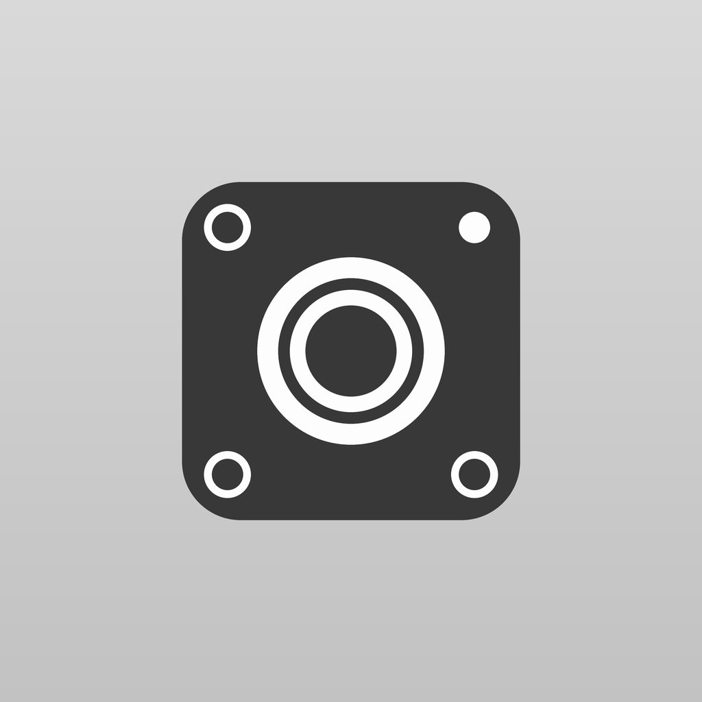
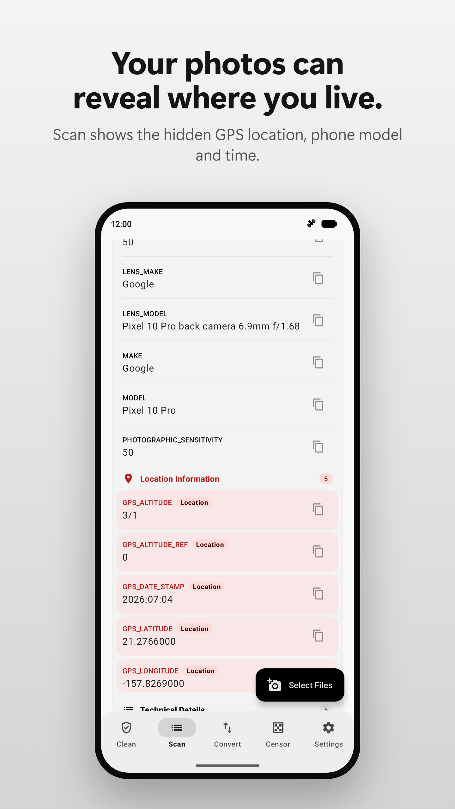
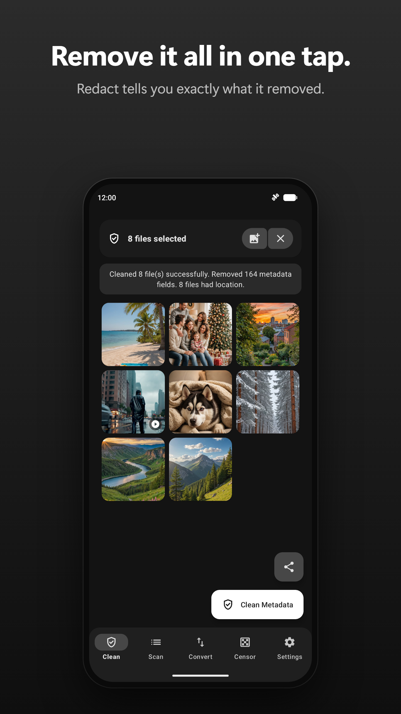
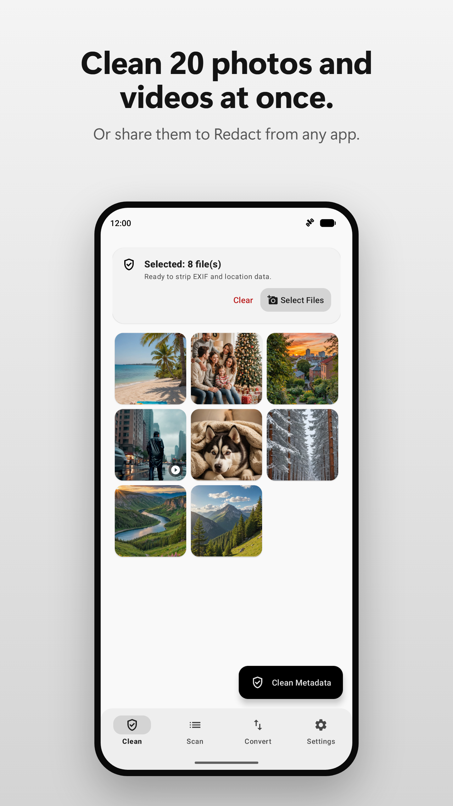
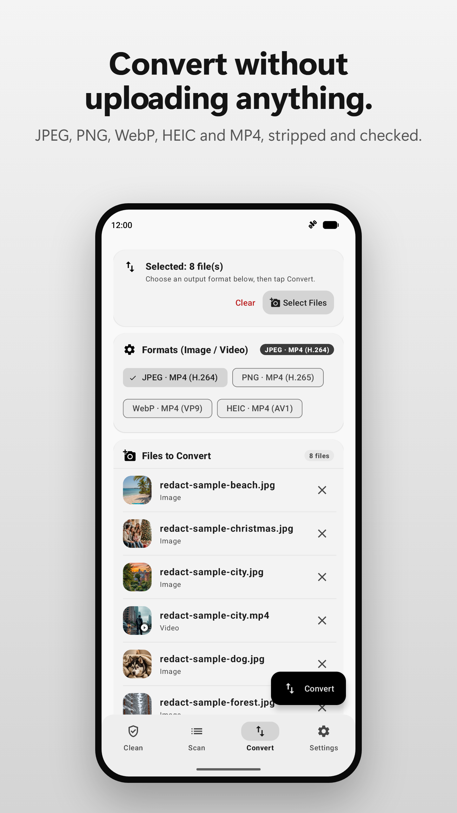

<p align="center">
  
</p>

<h1 align="center">Redact</h1>

<p align="center">
  <strong>Privacy &amp; metadata remover for Android.</strong><br>
  Strip the hidden location, device and time details from your photos and videos, check exactly what a file reveals before you share it, and convert formats, all on your phone.
</p>

<p align="center">
  <a href="https://play.google.com/store/apps/details?id=com.doubleangels.redact">
    
  </a>
</p>

<p align="center">
  
  
  
  
  
</p>

<p align="center">
  
  
  
  
</p>

---

## Table of Contents

**Using Redact**

- [What is Redact?](#what-is-redact)
- [Features](#features)
- [Getting started](#getting-started)
- [Using Redact](#using-redact)
- [What happens to your files](#what-happens-to-your-files)
- [Settings](#settings)
- [Privacy and security](#privacy-and-security)
- [FAQ](#faq)
- [Support and feedback](#support-and-feedback)

**Building and contributing**

- [For developers](#for-developers)
- [Contributing](#contributing)
- [Security](#security)
- [Built with](#built-with)
- [License](#license)

---

## What is Redact?

Every photo and video your phone takes carries a hidden label called **metadata**. Depending on your settings, that label can include:

- the **exact GPS location** where it was taken (often precise enough to find a house),
- the **date, time and time zone**,
- the **make and model** of your phone or camera,
- **camera settings** such as aperture, shutter speed and ISO,
- extra tags added by editing apps (XMP, IPTC, comments and video container tags),
- data hidden after the picture: extra preview images with their own location, Motion Photo clips and phone makers' own records.

Most apps and websites do not show you this, but anyone who receives the original file can read it. Redact removes it, lets you inspect what a file contains before you send it, and converts between formats, **without your files ever leaving your device**.

> **Short version:** pick a photo or video, tap **Clean Metadata**, and share the clean copy that Redact saves to your gallery.

---

## Features

| | |
|---|---|
| **Clean** | Removes GPS coordinates, device details, timestamps and other hidden EXIF and container metadata from images and videos, along with IPTC, comments, extra preview images and Motion Photo clips hidden inside photos. Strict Clean re-encodes video for the most thorough removal; Faster Video Cleaning is available on compatible files. When a clean finishes, Redact tells you what it removed and a **Share** button sends the clean copies on. |
| **Scan** | Shows a file's metadata in an organized, readable list *before* you decide what to do. Rows that reveal where a file was taken carry a **Location** badge. Search the list, copy values, send the file to Clean or Convert, or open the location in your maps app. |
| **Censor** | Pixelate, black out or blur faces, number plates, addresses and anything else in a photo with a rectangle or brush, with undo, redo and pinch-zoom. The censored copy is saved without metadata, and the original stays as it is. |
| **Statistics** | **Your Privacy Stats** at the top of Settings, and the **Statistics** screen it opens, show how many metadata fields and locations Redact has removed, which kinds of personal details your files carried, and your activity over the last 30 days. Counted only on your device and never sent anywhere. |
| **Convert** | Converts images between JPEG, PNG, WebP and HEIC (on supported devices) and video between H.264, H.265, VP9 and AV1. Converted files are stripped of metadata and checked afterward, so they do not carry the original's location or device details. |
| **Share into Redact** | Share a photo or video from any other app. Redact cleans it and reopens the share sheet with the clean copy, with an optional confirmation step and a progress dialog you can cancel. |
| **Open with Redact** | Open a photo or video in Redact from your gallery or file manager, or share it to **Scan with Redact**, and it goes straight to Scan. |
| **Shortcuts** | Long-press the app icon to jump straight to Clean, Scan, Convert or Censor, or add the **Clean**, **Scan** or **Censor** tiles to Quick Settings. |
| **Batches** | Clean or convert up to 100 files at once (50 when you share them in from another app). If some files fail, Redact keeps going and reports what succeeded. |
| **Large files** | There is no hard size cap. Redact warns you first when storage or memory looks too low for the job. |
| **Delete originals (optional)** | Turn on **Delete Originals After Cleaning** and Redact asks Android to move the originals to trash after a successful clean. Android shows its own confirmation, so nothing is removed without your say-so. |
| **Open source, no ads** | No ads and no behavioral tracking. The source is public for anyone to review. |
| **13 languages** | English, Spanish, French, German, Italian, Portuguese, Russian, Japanese, Korean, Chinese (Simplified and Traditional), Hindi and Arabic. Follows your phone's per-app language setting. |

---

## Getting started

### Install

[**Get Redact on Google Play**](https://play.google.com/store/apps/details?id=com.doubleangels.redact)

You can also build it yourself, see [For developers](#for-developers).

### Requirements

- Android 12 (API 31) or newer.
- A little free storage: Redact writes the cleaned copy next to your originals and warns you if space is tight.

### Your first clean

On first start, a short introduction explains what hidden metadata is and that your files never leave your phone. It then walks through each permission on its own page (photos and videos, photo and video locations, notifications), plus whether to send crash reports, saying what each is for before asking, so you can allow it or choose **Not Now**. The last page sums up your choices. See it again any time from Settings › About › **Show Introduction**.

1. Open Redact and tap the **Clean** tab.
2. Tap **Select Files** and choose photos or videos.
3. Tap **Clean Metadata**.
4. Read the summary of what was removed, then find the results in **Pictures/Redact** or **Movies/Redact** (or the folders you chose in Settings), or tap **Share** to send them straight away.

Your originals are never modified.

---

## Using Redact

### Clean

Removes metadata and saves a new copy to `Pictures/Redact` (images) or `Movies/Redact` (videos). Choose up to 100 files. Location data is removed unless you explicitly turn on **Keep Location** in Settings (this asks for confirmation and is ignored by Strict Clean).

When the clean finishes, Redact sums up what it removed, for example *"Removed 24 metadata fields, including location"* for one file, or the total and how many files had a location for a batch. Fields you chose to keep in Settings are not counted. The same summary appears in the completion notification if notifications are on. A **Share** icon button then appears above **Clean Metadata** to send the clean copies to another app. Convert shows a **Share** button when it finishes. After cleaning a single file, a **Scan Result** icon button also appears beside Share and opens the clean copy in Scan, so you can see exactly what is left. Long-press either icon to see its name.

### Scan

Pick **one** file to see everything embedded in it, grouped into sections such as image properties and technical details.

- **Location** badge: marks rows that reveal where the file was taken, such as GPS coordinates.
- **Hidden & embedded data:** a section for what lives outside the usual tags, such as IPTC captions and credits, comments, extra images or a Motion Photo clip stored after the picture, phone makers' own records, video container tags and data inside the video stream. Clean removes all of it.
- **Search:** type in the box above the list to filter it. Matches field names and values, ignoring case, and treats spaces and underscores alike, so `gps altitude` finds `GPS_ALTITUDE`. Typing a section's name, such as `camera` or `location`, shows that whole section. The search clears when you scan another file.
- **Copy:** copy a single value or the whole list. Copied values are flagged as sensitive on the clipboard on Android 13 and newer.
- **Open in Clean / Convert:** send the file on without picking it again.
- **Open location in maps:** hands the coordinates to your default maps app. Because that shares them with a separate app, Redact explains this and asks for permission the first time.
- To see GPS fields at all, grant the optional photo-location permission when asked.

### Opening files from other apps and shortcuts

- **Open with Redact:** when you open a photo or video from your gallery or file manager and choose Redact, it opens in Scan so you can check it before doing anything else.
- **Scan with Redact:** the share sheet also lists **Scan with Redact** next to Redact. It opens the shared photo or video in Scan instead of cleaning it.
- **Convert with Redact / Censor with Redact:** the share sheet also lists these. Shared files open in Convert, or a shared photo opens in Censor.
- **App shortcuts:** long-press the Redact icon on your home screen to go straight to Clean, Scan, Convert or Censor.
- **Quick Settings tiles:** add the **Clean**, **Scan** or **Censor** tile to open that tab from anywhere.

### Convert

Choose a target format (images: JPEG, PNG, WebP, HEIC where supported; video: H.264, H.265, VP9, AV1) and Redact writes the converted copy with metadata stripped and verified. The format you pick is kept when you change the selection.

### Censor

Pick one photo and cover anything that should stay private.

- **Rectangle:** drag to cover an area. Tap a rectangle to move or resize it, or delete it.
- **Brush:** paint over irregular shapes, with an adjustable brush size.
- **Move:** pinch to zoom and drag to pan. **Full Screen** gives the photo the whole screen.
- **Effect:** Pixelate, Black or Blur. Your tool, effect and brush size are remembered.
- **Undo / Redo**, and a prompt before discarding unsaved changes.
- **Save Copy** writes a censored copy with no metadata to your output folder, and a **Share** button sends it on. With **Delete Originals After Cleaning** on, Redact also asks Android to move the original to trash.

You can also reach Censor from Scan (**Censor This Photo**), from the icon that appears after cleaning a single photo, or by sharing a photo to **Censor with Redact**.

### Share into Redact

1. In any app, choose **Share** on a photo or video and pick **Redact**.
2. Confirm, if you have the confirmation step turned on.
3. Redact cleans the files locally and reopens the share sheet with the clean versions ready to send. Share-in always strips location data.
4. Cancel any time from the progress dialog.

### Where files go

Cleaned and converted files are saved through Android's MediaStore into `Pictures/Redact` or `Movies/Redact` by default. In Settings under **Output Folders** you can open the file browser to pick or create a different folder for images and for videos, on device storage or an SD card. The browser starts in `Pictures` or `Movies` (or in the folder you chose before), Settings shows the folder you picked, such as `Pictures/Private`, and **Reset to Default** (or picking the `Redact` folder itself) switches back. If a chosen folder is deleted or its SD card is removed, Redact saves to the default folder instead, says so once, and Settings shows a warning until you choose a folder again. Files you share in are held in the app's temporary cache and deleted once sharing finishes, with a short delay so the receiving app can finish reading them.

## What happens to your files

Redact always keeps as much of the original as it can. Where it can, it rebuilds a file from its own picture or video data and leaves out everything else, so nothing is recompressed. Where it has to decode and save again, it keeps the full resolution, frame rate and quality of the source. Every result is checked for leftover metadata before it is saved, and if anything is found, nothing is saved.

| What you do | What you start with | What you get | What is kept | Why |
|---|---|---|---|---|
| **Clean or share** | JPEG | JPEG | Every pixel, unchanged. Color profile, orientation and the HDR layer of an Ultra HDR photo | The file is rebuilt from its own picture data, so nothing is recompressed. Only the parts a viewer needs are copied, so metadata Redact has never heard of can't slip through. The HDR layer is cleaned too and keeps only its brightness numbers. |
| | PNG, including animated PNG | PNG | Every pixel, every frame, transparency, color profile and HDR color info | Rebuilt the same way. |
| | WebP, including animated WebP | WebP | Every pixel and every frame, transparency and color profile | Rebuilt the same way. |
| | HEIC or HEIF, including bursts and animations | HEIC | The compressed pictures byte for byte, so full resolution, 10-bit color, the HDR layer, depth and transparency layers and every frame | Rebuilt around its pictures on every Android version, so no HEIC encoder is needed. In bursts and animations, dates, the encoder's name and location boxes are removed and sound tracks are left out. |
| | AVIF, including animated AVIF | AVIF | The same as HEIC | Rebuilt the same way. Android can't save AVIF any other way. |
| | GIF, including animated GIF | GIF | Every frame, its timing and transparency, and the loop count | Rebuilt block by block. Comments, XMP and other text inside the GIF are removed. |
| | BMP | PNG | Every pixel | Android can't save BMP, and PNG is just as exact. |
| | Other images Android can open, such as DNG | JPEG at High quality | Full resolution | These formats can't be rebuilt, so the picture is decoded and saved as a JPEG. |
| | Images Android can't open, such as SVG and TIFF | Nothing | | Redact says the format isn't supported instead of guessing. |
| | Motion Photo (a photo with a short video inside) | The photo | The photo as above | The clip is a separate video with its own metadata, so it is removed and the photo becomes an ordinary still. |
| **Clean** a video | H.264 | MP4, H.264 | The source's size, frame rate and bitrate | The video is encoded again, because that is the only way to remove data hidden inside the video stream itself, such as a camera's GPS or a drone's flight log. |
| | H.265 (HEVC) | MP4, H.265 | The same, and HDR where the phone can encode it | Same reason. HDR becomes SDR only on phones that can't encode HDR. |
| | AV1 | MP4, AV1 | The same as H.265 | If the phone has no AV1 encoder, Redact uses H.265, then H.264. |
| | VP8 or VP9 | MP4, VP9 | The same, in SDR | If the phone has no VP9 encoder, Redact uses H.265, then H.264. |
| | Any other codec, such as MPEG-4 or H.263 | MP4, H.264 | The same | Older codecs are saved in the most widely played one. |
| **Share** a video | Any video | MP4, H.264 | The source's size, frame rate and bitrate. HDR becomes SDR on most phones | Every app you might share to can play H.264. |
| **Convert** an image | Any image Android can open | JPEG, PNG, WebP or HEIC, as you choose | Full resolution. A JPEG made from a JPEG is never saved below the original's quality on High. WebP made from PNG, GIF, BMP or lossless WebP is lossless | Converting decodes the picture and saves it in the new format. Transparent areas become white in JPEG and HEIC, which can't store transparency. Animations keep their first frame. HEIC needs Android 14, and JPEG is used before that. |
| **Convert** a video | Any video Android can play | MP4 in H.264, H.265, VP9 or AV1, as you choose | The same as Clean | If the phone can't encode the codec you chose, Redact uses H.265, then H.264. |
| **Censor** a photo | JPEG, PNG, WebP | The same format | Full resolution. WebP stays lossless if it was. On Android 14 and newer an Ultra HDR photo can keep its HDR layer, with the censored areas blanked in it too | The censored picture has to be encoded again. The HDR layer is a small picture of where the scene is bright, so Redact censors it as well, or it could still show the outline of what you covered. |
| | HEIC | HEIC on Android 14 and newer, JPEG before | Full resolution | HEIC can only be saved on Android 14 and newer. |
| | GIF or BMP | PNG | Full resolution, first frame | PNG keeps every pixel exactly. |
| | AVIF and anything else | JPEG at High quality | Full resolution | Android can't save AVIF. |

**Video details.** Audio is saved as AAC (Opus alongside VP9) at the source's bitrate or 128 kbps, whichever is higher, with every channel. If the phone's hardware encoder can't handle the source's size and frame rate, Redact uses the closest it can, such as 4K at 30 fps for a 4K 60 fps video on a phone that only encodes 4K at 30 fps, and keeps the bitrate in proportion. Only the first video and audio track are kept, so extra audio tracks, subtitles, chapters, timed data tracks (such as GPS or sensor logs) and slow-motion markers are left out.

**Faster Video Cleaning.** When this setting is on and Strict Clean is off, an H.264 or H.265 video is copied into a new MP4, and a VP8 or VP9 video into a new WebM, without encoding it again, so the picture and sound are identical. Shared videos never use this. Redact only does this when the video stream has no data hidden inside it, and otherwise encodes it as above.

**What is kept from EXIF.** Orientation is always kept. With Strict Clean off, camera settings and location can be kept too (see Settings). This only works for JPEG, PNG and WebP. HEIC, AVIF and GIF can't take tags back, so they keep no EXIF at all, and HEIC and AVIF keep their orientation in their own rotation box instead. Shared files always keep only their orientation.

**When a rebuild can't be done.** A damaged file or an unusual layout can't always be rebuilt. Then the picture is decoded at full resolution and saved again in the same format if Android can save it, as PNG for a GIF, and as a high-quality JPEG otherwise. The new file is named for what it really is.

**Resolution.** Images are always processed at full resolution. They are only scaled down when the phone doesn't have enough free memory to hold the whole picture, and then only as far as needed.

---

## Settings

**Your Privacy Stats** sits at the top of the Settings tab with your totals; tap it to open **Statistics**, where **Clear Statistics** sets every count back to zero. Reset All Settings leaves the statistics alone.

The Settings tab puts the settings you use every day first: cleaning, sharing, Convert, output folders, privacy and notifications. Below them are the ones you rarely need (permissions, large files, storage, diagnostics and Reset All Settings), and About with its links comes last. It is grouped the same way as the tables below.

**Metadata Cleaning**: what the Clean tab removes.

| Setting | What it does |
|---|---|
| **Strict Clean** | Removes every trace of metadata, even the orientation tag (a rotated photo may look sideways afterward), turns off the keep options, and always fully re-encodes video for the most thorough clean. |
| **Keep Camera Settings** | Keeps aperture, shutter speed, ISO and camera make/model on the Clean tab. Ignored with Strict Clean and for shared-in files. |
| **Keep Location** | Keeps GPS coordinates on the Clean tab (confirmation required; off by default). Ignored with Strict Clean and for shared-in files, which always lose location. |
| **Faster Video Cleaning** | When a video is already in a compatible format, strips its metadata with a quick pass instead of re-encoding. Faster and lighter on battery; a full re-encode removes a touch more. Turned off automatically with Strict Clean and for shared-in files. |

**Before & After Cleaning**

| Setting | What it does |
|---|---|
| **Warn About Already-Clean Files** | Before cleaning, tells you when selected files have no metadata to remove or are copies Redact already made, and lets you skip them, clean everything anyway or cancel. On by default; nothing about your files is stored to do this. |
| **Delete Originals After Cleaning** | Asks Android to move the originals to trash after a successful clean. Android confirms each time. |

**Sharing Into Redact**

| Setting | What it does |
|---|---|
| **Confirm Before Removing Metadata** | Asks before cleaning files shared into Redact. |

**Convert Tab Defaults**

| Setting | What it does |
|---|---|
| **Default formats and image quality** | The formats and quality pre-selected on the Convert tab. You can still change them for each batch. |

**Output Folders**

| Setting | What it does |
|---|---|
| **Images** / **Videos** | Tap a folder to open the file browser and pick or create where cleaned and converted files go. After you pick one, Redact offers to use it for the other media type too. Defaults are `Pictures/Redact` and `Movies/Redact`; **Reset to Default** restores either. Existing files are not moved. |
| **Open Folder** | Shows the folder in your file manager. |
| **Keep Original File Names** | Names cleaned and converted files after the originals (for example `IMG_20260117_093012.jpg`) instead of a random name. Off by default, because such names can reveal when a photo was taken. Files shared into Redact always get a random name. |
| Unavailable folder | If a chosen folder is deleted or its storage is removed, Redact saves to the default instead and marks the folder in red here. |

**Privacy**

| Setting | What it does |
|---|---|
| **Hide Content in Screenshots and Recents** | Blocks screenshots and screen recording inside Redact and blanks its preview on the recent apps screen, so metadata and thumbnails of private photos are not captured. Off by default; takes effect immediately. |
| **Clear Copied Metadata** | Clears metadata you copied from Scan off the clipboard after 15 seconds, 30 seconds, 1 minute or 5 minutes, unless you have copied something else since. Off by default. |

**Notifications**

| Setting | What it does |
|---|---|
| **Allow Notifications** / **Ongoing Task Progress** | Alerts when jobs finish and optional live progress. Off until you turn them on. |

**Permissions** shows what Redact can access and lets you grant the optional photo-location permission.

**Storage & Cache**

| Setting | What it does |
|---|---|
| **Clear Cache on Startup** / **Clear Temporary Files** | Removes processing cache older than 24 hours when the app opens, or on demand. |
| **Secure Deletion Passes** | How many times temporary files are overwritten before deletion. More passes are slower, and recovery may still be possible on flash storage. |

**Diagnostics & Feedback**

| Setting | What it does |
|---|---|
| **Send Crash Reports** | Optional anonymized crash diagnostics through Sentry, off by default, with a consent prompt. On first start the introduction asks once, on its own page, whether to turn it on; choosing Not Now leaves it off. |

**Reset All Settings** puts every setting back to its default and forgets the chosen output folders. Your files are not touched.

**About**: version, links, **Open-Source Licenses** (every library Redact ships, with its full license text, readable offline), **Show Introduction** and **Rate Redact on Google Play**.

Open the Settings tab in the app for the full list.

---

## Privacy and security

- **Your files stay on your device** for every core feature. Cleaning, scanning and converting never need a network connection.
- **No ads, no behavioral tracking, no analytics.**
- **Two optional things can touch the network or another app:**
  1. **Send Crash Reports** (off by default) sends anonymized diagnostics to [Sentry](https://sentry.io): device model, Android version, app version, stack traces and a few scrubbed tags. File paths, filenames and GPS coordinates are removed before anything is sent. Your photos and videos are **never** uploaded. Sentry keeps the reports for a limited time, 90 days for crash and error reports and 30 days for performance data and logs, see its [data retention periods](https://docs.sentry.io/security-legal-pii/security/data-retention-periods/).
  2. **Open in maps** from Scan hands coordinates to your default maps app, only after your explicit one-time consent.
- **Statistics stay on your phone.** The counts behind Your Privacy Stats are stored only in Redact's private storage, are left out of backups and device transfers, and are never included in crash reports.
- **Permissions are minimal.** On Android 13 and newer Redact uses the system document picker, so it can reach Downloads, Files and gallery folders without broad media access.

| Permission | Why | Required? |
|---|---|---|
| `READ_MEDIA_IMAGES` / `READ_MEDIA_VIDEO` (or partial access on Android 14+) | Reading your gallery in some situations | Optional |
| `READ_EXTERNAL_STORAGE` | Gallery access on Android 12 and earlier | Where applicable |
| `ACCESS_MEDIA_LOCATION` | Lets Scan read GPS coordinates embedded in your media | Optional |
| `POST_NOTIFICATIONS` | Progress and completion notifications | Optional, off until you enable it |
| `FOREGROUND_SERVICE` | Keeps long clean or convert jobs running with a progress notification | Used during jobs |

- **Open source.** Read the code; that is the point.

**[Privacy Policy](https://doubleangels.github.io/privacypolicy/redact.html)**

---

## FAQ

<details>
<summary><b>What exactly is EXIF data?</b></summary>

EXIF (Exchangeable Image File Format) is the metadata block cameras and phones write into photos. Video files carry similar information in their container. Common contents: GPS location, date, time and time zone, device make and model, camera settings, and XMP / IPTC / container tags added by other apps.
</details>

<details>
<summary><b>Does Redact change the quality of my photos or videos?</b></summary>

Cleaning keeps photos exactly as they are. JPEG, PNG, WebP, HEIC, AVIF and GIF files are rebuilt from their own picture data without recompressing, so every pixel, every frame of an animation, and the HDR layer of an Ultra HDR photo are kept. The moving part of a Motion Photo is removed, so it becomes an ordinary still photo. Videos are encoded again at the source's size, frame rate and bitrate (unless Faster Video Cleaning applies). See [What happens to your files](#what-happens-to-your-files) for every case.
</details>

<details>
<summary><b>Does Convert remove metadata too?</b></summary>

Yes. Images are re-encoded without their EXIF data. Videos have metadata removed before transcoding and are checked afterward. The original file is never modified.
</details>

<details>
<summary><b>Does Redact need an internet connection?</b></summary>

No. Only the two optional features above (crash reports and opening a location in a maps app) can use the network, and both are off until you choose them.
</details>

<details>
<summary><b>Where does Redact store my files?</b></summary>

In `Pictures/Redact` and `Movies/Redact`. See [Where files go](#where-files-go).
</details>

<details>
<summary><b>Are there file size limits?</b></summary>

No hard limit. Very large files can still strain a device that is low on storage or memory, so Redact warns you before it starts. Images are always processed at full resolution, and only scaled down if the device does not have the free memory to hold one.
</details>

<details>
<summary><b>Does Redact use analytics or trackers?</b></summary>

No. The only thing of this kind is the optional Sentry crash reporting described in [Privacy and security](#privacy-and-security).
</details>

<details>
<summary><b>Why does Scan show nothing about location?</b></summary>

Either the file has no location data, or you have not granted the optional photo-location permission, which Android requires before apps can read GPS fields in your photos.
</details>

<details>
<summary><b>Can I use Redact on Android 11 or older?</b></summary>

No, Android 12 (API 31) is the minimum.
</details>

---

## Support and feedback

- **Something not working?** Check the [FAQ](#faq) first, then look through the [existing issues](https://github.com/doubleangels/redact/issues) in case it has already been reported.
- **Found a bug or have an idea?** [Open an issue](https://github.com/doubleangels/redact/issues/new). Include your Android version, device model, app version and the steps to reproduce.
- **Please do not attach photos or files that contain private information** to a public issue. Describe them instead, or use a sample file.
- **Want to help translate?** See [Translations](#translations).

---

## For developers

### Requirements

- **JDK 21**
- **Android Studio** (recent stable) with the **Android SDK 37** installed
- An Android device or emulator on API 31 or newer (API 37 for the screenshots script)

### Build and run

```bash
git clone https://github.com/doubleangels/redact.git
cd redact

./gradlew assembleDebug      # build a debug APK
./gradlew installDebug       # build and install on the connected device or emulator
```

On Windows use `gradlew.bat`, or Git Bash.

### Test and lint

```bash
./gradlew testDebugUnitTest  # unit tests (Robolectric, no device needed)
./gradlew lintRelease        # Android Lint
```

CI runs `./gradlew test` and Android Lint on every push to `dev` and on every pull request.

### Optional: crash reporting while developing

Crash reporting is off unless a Sentry DSN is supplied at build time. Debug builds look for it, in order, in the `SENTRY_DSN` environment variable, a `sentry.dsn.local` file at the repo root (copy `sentry.dsn.local.example`; it is gitignored), or `sentry.dsn` in `local.properties`. Release builds read `SENTRY_DSN` from the environment only. You do not need a DSN to build, run or test the app.

### Project layout

```
app/src/main/java/com/doubleangels/redact/
  CleanFragment, ScanFragment, ConvertFragment, SettingsFragment   the four tabs
  MainActivity, ShareHandlerActivity                               entry points (share-in)
  StatisticsActivity                                               the Statistics screen
  media/          selecting, processing, converting, MediaStore writes, secure delete
  metadata/       reading (Scan) and stripping metadata
  notifications/  progress notifications and the foreground service
  permission/     permission checks and status
  sentry/         opt-in crash reporting and the privacy scrubber
  stats/          on-device counts behind Statistics
  ui/             view models, adapters, clipboard helper
app/src/test/                  unit tests (Robolectric; fake MediaStore provider)
baselineprofile/               macrobenchmark module that generates the baseline profile
fastlane/metadata/             Google Play listing text, screenshots and icon
legal/                         source of the privacy policy page
scripts/                       store screenshots, feature graphic and sample-media tagging
site/                          the website: landing page and guides
.github/workflows/             CI, release and privacy-policy publishing
```

### Baseline profile

Startup performance comes from a generated baseline and startup profile in `app/src/release/generated/baselineProfiles/`. Regenerate it on a connected device or emulator after meaningful startup-path changes:

```bash
./gradlew :app:generateBaselineProfile
```

If more than one device is connected, set `ANDROID_SERIAL` (for example `emulator-5554`) first.

### Store screenshots and feature graphic

`scripts/screenshots.sh` builds the debug app, boots (or reuses) an API 37 emulator, clears Redact's app data there, applies a black-and-white system theme, and captures Clean (selected and finished), Scan (scrolled to the camera and location rows) and Convert, light and dark, from the sample media in `icons/sample`. It then runs `scripts/store_graphics.py`, which frames them with captions and draws the 1024×500 feature graphic using headless Chrome or Edge, into `build/store/<locale>/`. Set `LOCALES=all` (or a list such as `LOCALES="de-DE fr-FR"`) to capture each store language with the app switched to it; the default is `en-US`. Run it from Git Bash on Windows. See the header of each script for details.

The samples carry real-looking GPS, camera and time metadata (public landmarks, never a real home) so the screenshots show what Redact finds; `python scripts/tag_samples.py` re-applies it after adding or replacing a sample.

### Website

`site/` holds the landing page and the how-to guides published at <https://doubleangels.github.io/redact/> by `.github/workflows/publish-site.yml` whenever a change to it reaches `main`. It loads nothing from other sites: no fonts, scripts or trackers. When you add a page, add it to `site/sitemap.xml`.

### Releases

- Day-to-day work happens on the `dev` branch; dependency updates also target `dev`.
- A release is built from `main` by the manually triggered **Release Deployment** workflow: tests, lint, a signed app bundle, then publication to Google Play behind a protected `production` environment.
- The Play listing text and images come from `fastlane/metadata`.

### Translations

User-facing strings live in `app/src/main/res/values*/strings.xml`. When you add or change a string, add it to **every** locale folder (`ar`, `de`, `es`, `fr`, `hi`, `it`, `ja`, `ko`, `pt`, `ru`, `zh-rCN`, `zh-rTW`) and use plurals for counts. Machine-written translations are welcome to native-speaker corrections.

---

## Contributing

Contributions are welcome, from typo fixes and translations to new features. Read **[CONTRIBUTING.md](CONTRIBUTING.md)** for the workflow, the checks to run and the localization rules. In short: fork, branch from `dev`, add tests, run `./gradlew testDebugUnitTest` and `./gradlew lintRelease`, and open a pull request against `dev`.

Privacy is the product: changes that add network access, tracking, new permissions or new data collection need a clear justification and will get extra scrutiny.

---

## Security

Please do not report vulnerabilities in a public issue. See **[SECURITY.md](SECURITY.md)** for how to report one privately.

---

## Built with

Java, Android Jetpack and Material 3, [Media3 Transformer](https://developer.android.com/media/media3/transformer) for video and [AndroidX ExifInterface](https://developer.android.com/jetpack/androidx/releases/exifinterface) for metadata, [Glide](https://github.com/bumptech/glide) for thumbnails, [Sentry](https://sentry.io) for opt-in crash reporting, and [Robolectric](https://robolectric.org) and JUnit for tests. Releases are published with [Fastlane](https://fastlane.tools).

---

## License

Redact is released under the [GNU General Public License v3.0](LICENSE).

### Name and icon

The GPL covers the code, not the Redact name or icon. You are welcome to fork, modify and redistribute the code under the GPL, but a published fork must use its own name and icon and must not present itself as Redact or as made by its developer.

---

<p align="center">
  Thank you for trusting Redact to help protect your privacy. 💙
</p>
