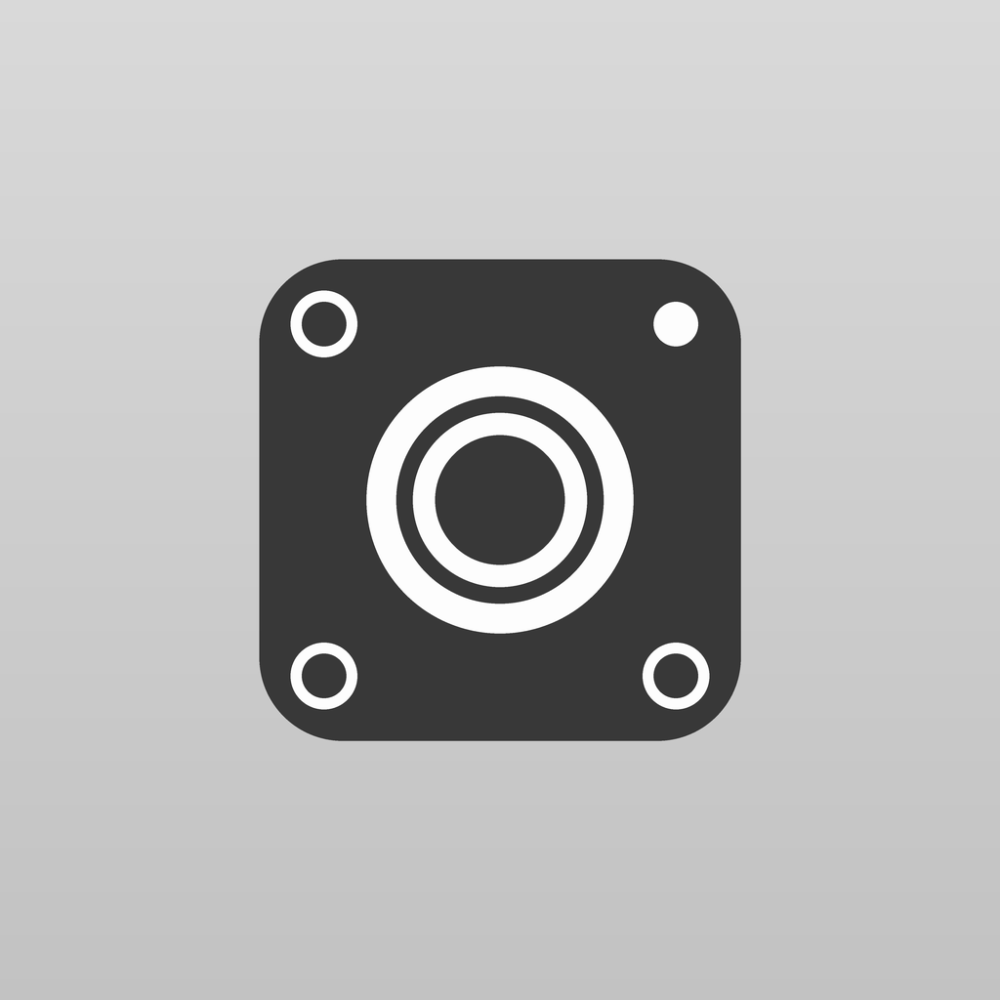
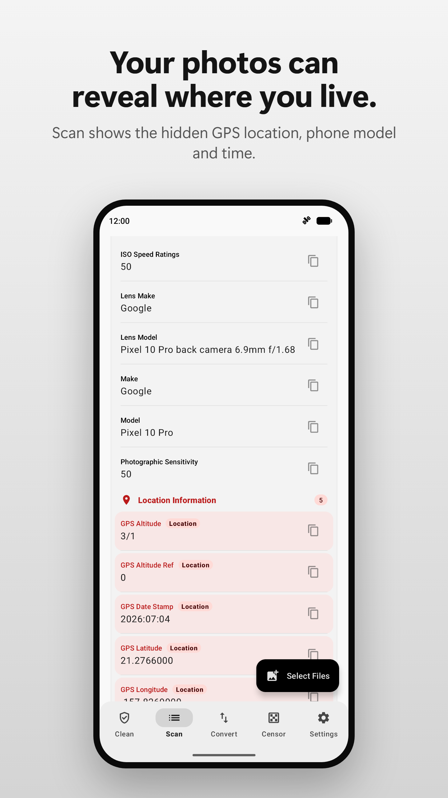
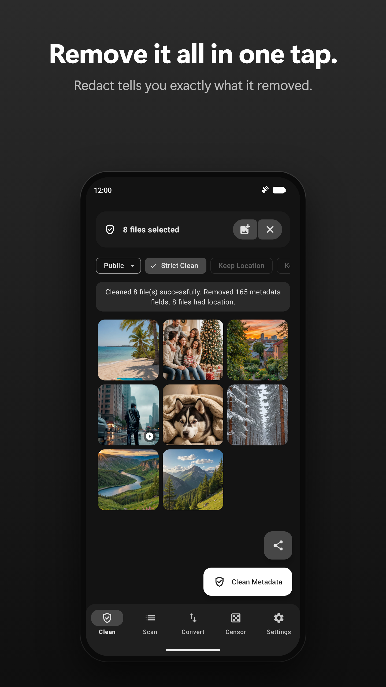
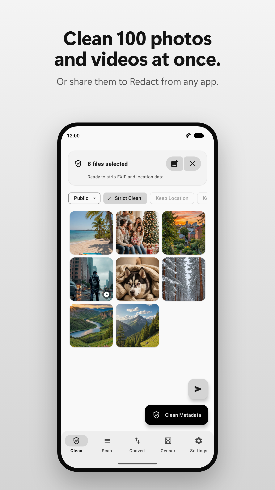
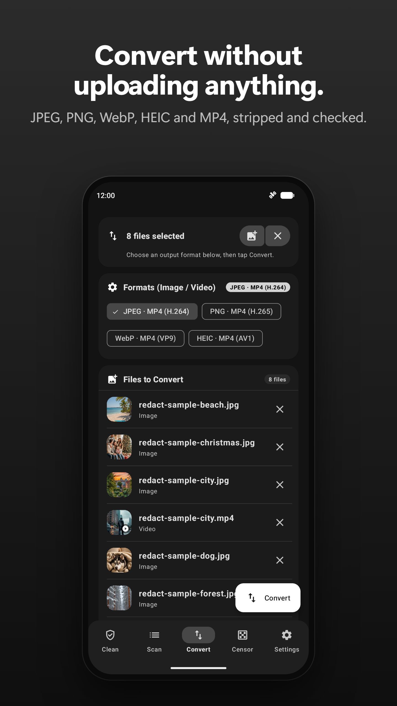

<p align="center">
  
</p>

<h1 align="center">Redact</h1>

<p align="center">
  <strong>Privacy &amp; metadata remover for Android.</strong><br>
  Strip the hidden location, device and time details from your photos and videos, check exactly what a file reveals before you share it, and convert formats, all on your phone.
</p>

<p align="center">
  <a href="https://play.google.com/store/apps/details?id=com.doubleangels.redact">
    
  </a>
</p>

<p align="center">
  <strong>Using Redact?</strong> It's made by one person, with no ads and no marketing budget.<br>
  A short <a href="https://play.google.com/store/apps/details?id=com.doubleangels.redact">review on Google Play</a>, saying what you use it for, is the biggest help there is: it's how other people find it.
</p>

<p align="center">
  
  
  
  
  
</p>

<p align="center">
  
  
  
  
</p>

---

## Table of Contents

**Using Redact**

- [What is Redact?](#what-is-redact)
- [Features](#features)
- [Getting started](#getting-started)
- [Using Redact](#using-redact)
- [What happens to your files](#what-happens-to-your-files)
- [How Redact makes sure your files come out clean](#how-redact-makes-sure-your-files-come-out-clean)
- [Settings](#settings)
- [Privacy and security](#privacy-and-security)
- [FAQ](#faq)
- [Support and feedback](#support-and-feedback)

**Building and contributing**

- [For developers](#for-developers)
- [Contributing](#contributing)
- [Security](#security)
- [Built with](#built-with)
- [License](#license)

---

## What is Redact?

Every photo and video your phone takes carries a hidden label called **metadata**. Depending on your settings, that label can include:

- the **exact GPS location** where it was taken (often precise enough to find a house),
- the **date, time and time zone**,
- the **make and model** of your phone or camera,
- **camera settings** such as aperture, shutter speed and ISO,
- notes added by editing and social apps, such as captions, credits and comments,
- extras tucked inside the file: small preview images (sometimes with their own location), the short video in a Motion Photo, and phone makers' own records.

Most apps and websites do not show you this, but anyone who receives the original file can read it. Redact removes it, lets you inspect what a file contains before you send it, and converts between formats, **without your files ever leaving your device**.

> **Short version:** pick a photo or video, tap **Clean Metadata**, and share the clean copy that Redact saves to your gallery.

---

## Features

| | |
|---|---|
| **Clean** | Removes the location, device details, dates and other hidden information from photos and videos, including extra preview images and the short video inside a Motion Photo (or, with **Keep Motion Photos**, just that video's own hidden information). **Strict Clean** gives the most thorough clean, and **Faster Video Cleaning** speeds up videos that allow it. When a clean finishes, Redact tells you what it removed, and a **Share** button sends the clean copies on. |
| **Scan** | Shows a file's metadata in an organized, readable list *before* you decide what to do. Rows that reveal where a file was taken carry a **Location** badge. Search the list, copy values, share the whole list as text, send the file to Clean or Convert, or open the location in your maps app. Pick several files to see at a glance how many have a location, a date, a phone's name or a person's name. |
| **Censor** | Pixelate, black out or blur faces, number plates, addresses and anything else in a photo with a rectangle or brush, and crop away what shouldn't be in it at all, with undo, redo and pinch-zoom. The censored copy is saved without metadata, and the original stays as it is. |
| **Statistics** | **Your Privacy Stats** at the top of Settings, and the **Statistics** screen it opens, show how many metadata fields and locations Redact has removed, which kinds of personal details your files carried, and your activity over the last 30 days. Counted only on your device and never sent anywhere. |
| **Convert** | Converts images between JPEG, PNG, WebP and HEIC (on supported devices), and videos between H.264, H.265, VP9 and AV1. Converted files are checked for hidden information before they're saved, so they don't carry the original's location or device details. |
| **Share into Redact** | Share a photo or video from any other app. Redact cleans it and reopens the share sheet with the clean copy, with an optional confirmation step and a progress dialog you can cancel. |
| **Open with Redact** | Open a photo or video in Redact from your gallery or file manager, or share it to **Scan with Redact**, and it goes straight to Scan. |
| **Shortcuts** | Long-press the app icon to jump straight to Clean, Scan, Convert or Censor, or add the **Clean**, **Scan** or **Censor** tiles to Quick Settings. |
| **Batches** | Clean or convert up to 100 files at once (50 when you share them in from another app). If some files fail, Redact keeps going, reports what succeeded, lists the files it couldn't clean with the reason, and can try just those again. |
| **Drag, drop and paste** | Drag photos and videos onto Clean, Scan, Convert or Censor from another app in split screen, on a tablet or on a Chromebook, or paste them with **Paste** or Ctrl+V. |
| **Large files** | There is no hard size cap. Redact warns you first when storage or memory looks too low for the job, and a file shared in that would leave less than 256 MB free is skipped rather than allowed to fill your storage. |
| **Delete originals (optional)** | Turn on **Delete Originals After Cleaning** and Redact asks Android to move the originals to trash after a successful clean. Android shows its own confirmation, so nothing is removed without your say-so. |
| **Open source, no ads** | No ads and no tracking. The source code is public, so anyone can check how Redact works. |
| **13 languages** | English, Spanish, French, German, Italian, Portuguese, Russian, Japanese, Korean, Chinese (Simplified and Traditional), Hindi and Arabic. Follows your phone's per-app language setting. |

---

## Getting started

### Install

[**Get Redact on Google Play**](https://play.google.com/store/apps/details?id=com.doubleangels.redact)

You can also build it yourself, see [For developers](#for-developers).

### Requirements

- Android 12 (API 31) or newer.
- Some free storage for the cleaned copies. Redact warns you if space is running low.

### Your first clean

On first start, a short introduction explains what hidden metadata is and that your files never leave your phone. It then walks through each permission on its own page (photos and videos, photo and video locations, notifications), plus whether to send crash reports, saying what each is for before asking, so you can allow it or choose **Not Now**. The last page sums up your choices. See it again any time from Settings › About › **Show Introduction**.

1. Open Redact and tap the **Clean** tab.
2. Tap **Select Files** and choose photos or videos.
3. Tap **Clean Metadata**.
4. Read the summary of what was removed, then find the results in **Pictures/Redact** or **Movies/Redact** (or the folders you chose in Settings), or tap **Share** to send them straight away.

Your originals are never modified.

---

## Using Redact

### Clean

Removes hidden information and saves a new copy to `Pictures/Redact` (images) or `Movies/Redact` (videos). You can choose up to 100 files at a time. The location is always removed unless you turn on **Keep Location** in Settings, which asks you to confirm and is ignored by Strict Clean. Settings can also keep the camera details, the date taken and the video in a Motion Photo; see [Settings](#settings).

Above the files, chips for **Strict Clean**, **Keep Location**, **Keep Date Taken**, **Keep Camera Settings** and **Remove Audio** change those settings without a trip to Settings. They are the same settings, so a change stays for the next batch, and Keep Location asks first as it does in Settings.

When the clean finishes, Redact sums up what it removed, such as *"Removed 24 metadata fields, including location"* for one file, or the total and how many files had a location for a batch. Anything you chose to keep isn't counted. If notifications are on, the same summary appears there too. Two buttons then appear above **Clean Metadata**:

- **Share** sends the clean copies to another app.
- **Scan Result**, after cleaning a single file, opens the clean copy in Scan so you can see exactly what's left.
- **Open**, after cleaning a single file, shows the clean copy in your photo or video viewer.

Long-press any of these buttons to see its name. Convert also shows **Share**, **Scan Result** and **Open** when it finishes, and Censor does after a save.

If some files could not be cleaned, a **Failed Files** button lists each one with the reason: a format this phone can't open, not enough memory, or a file that couldn't be cleaned safely, so nothing was saved. **Retry Failed** cleans just those again (a format the phone can't open is left out, as it would fail the same way).

**Share Without Saving** sends the selected files on without keeping copies in your gallery. It shows above **Clean Metadata** while files are selected, cleans them the way a share into Redact does (the location is always removed and the Keep options do not apply), opens the share sheet, and deletes the clean copies afterwards. Up to 50 files at a time.

### Scan

Pick **one** file to see everything embedded in it, grouped into sections such as image properties and technical details. Pick **several** and Scan reads them all and sums up how many have a location, a date, the name of a phone or camera, or a person's name, how many have nothing to remove and which ones have a location, with a button to send them all to Clean.

- **Location** badge: marks rows that reveal where the file was taken, such as GPS coordinates.
- **Hidden & embedded data:** everything stored outside the usual tags, such as captions and credits, comments, extra preview images, the video inside a Motion Photo, phone makers' own records, information hidden inside a video's picture, and the extra items HEIC, AVIF and GIF files can carry (such as depth maps that record the shape of a scene). Clean removes all of it, except a Motion Photo's video when **Keep Motion Photos** is on, which it keeps with that video's own hidden information removed. Parts the picture needs, such as its color profile or the HDR layer of an Ultra HDR photo, are listed too, so you know they stay.
- **Search:** type in the box above the list to filter it. Matches field names and values, ignoring case, and treats spaces and underscores alike, so `gps altitude` finds `GPS_ALTITUDE`. Typing a section's name, such as `camera` or `location`, shows that whole section. The search clears when you scan another file.
- **Copy:** copy a single value or the whole list. Copied values are flagged as sensitive on the clipboard on Android 13 and newer.
- **Share as Text:** hands the whole list to an app you pick, for a support question or to show someone what a file gives away. The first time, Redact says that the list can include where and when the file was made and who made it.
- **Open in Clean / Convert:** send the file on without picking it again.
- **Open location in maps:** hands the coordinates to your default maps app. Because that shares them with a separate app, Redact explains this and asks for permission the first time.
- To see GPS fields at all, grant the optional photo-location permission when asked.

### Opening files from other apps and shortcuts

- **Open with Redact:** when you open a photo or video from your gallery or file manager and choose Redact, it opens in Scan so you can check it before doing anything else.
- **Scan with Redact:** the share sheet also lists **Scan with Redact** next to Redact. It opens the shared photo or video in Scan instead of cleaning it.
- **Convert with Redact / Censor with Redact:** the share sheet also lists these. Shared files open in Convert, or a shared photo opens in Censor.
- **Drag and drop, and paste:** drag photos or videos from another app onto Clean, Scan, Convert or Censor, or copy them in another app and tap **Paste** (shown while the clipboard holds a photo or video) or press Ctrl+V. They get the same checks as a share, so only another app's files are taken.
- **App shortcuts:** long-press the Redact icon on your home screen to go straight to Clean, Scan, Convert or Censor.
- **Quick Settings tiles:** add the **Clean**, **Scan** or **Censor** tile to open that tab from anywhere.

### Convert

Choose a format (images: JPEG, PNG, WebP, or HEIC where supported; videos: H.264, H.265, VP9 or AV1), and Redact saves a converted copy that has been checked for hidden information first. Converting to PNG keeps the full color depth of a 16-bit PNG or a 10-bit HEIC or AVIF. The format you pick stays selected when you change the files.

### Censor

Pick one photo and cover anything that should stay private.

- **Rectangle:** drag to cover an area. Drag a rectangle to move it, or tap it to resize it from its corner and edge handles or delete it.
- **Brush:** paint over irregular shapes, with an adjustable brush size.
- **Zoom:** pinch with two fingers to zoom and pan with any tool. **Move** also pans with one finger and zooms on a double-tap. **Full Screen** gives the photo the whole screen.
- **Crop:** drag a corner or an edge of the frame to keep only part of the photo, drag inside it to move it, or drag outside it to draw a new one. What the crop leaves out is dimmed and is not saved, not even in an Ultra HDR photo's HDR layer. **Reset Crop** puts the whole photo back, and a crop can be undone like any other change.
- **Effect:** Pixelate, Blur or Black, for each area: new areas get the effect selected in the toolbar, and choosing an effect with a rectangle selected changes that rectangle. Your tool, effect and brush size are remembered.
- **Undo / Redo**, and a prompt before discarding unsaved changes.
- **Save Copy** writes a censored copy to your output folder at full resolution and in the photo's own format, keeping only the tags your Clean settings keep (never the original's small preview image, depth map or Motion Photo clip, which could still show what you covered), and a **Share** button sends it on. With **Delete Originals After Cleaning** on, Redact also asks Android to move the original to trash.

You can also reach Censor from Scan (**Censor This Photo**), from the icon that appears after cleaning a single photo, or by sharing a photo to **Censor with Redact**.

### Share into Redact

1. In any app, choose **Share** on a photo or video and pick **Redact**.
2. Confirm, if you have the confirmation step turned on.
3. Redact cleans the files on your phone and reopens the share sheet with the clean versions ready to send. Files shared in always lose their location.
4. Cancel any time from the progress dialog.

### Where files go

Cleaned and converted files go to `Pictures/Redact` and `Movies/Redact` by default.

- **Choosing another folder:** in Settings under **Output Folders**, open the file browser to pick or create a folder for images and one for videos, on your phone or an SD card. Settings shows the folder you picked, such as `Pictures/Private`, and **Reset to Default** switches back.
- **If a folder disappears:** if a chosen folder is deleted or its SD card is removed, Redact saves to the default folder instead, tells you once, and shows a warning in Settings until you choose again.
- **Files you share in** are kept in Redact's private temporary storage and deleted shortly after sharing finishes, once the receiving app has had time to read them.

## What happens to your files

This section is a detailed reference for each kind of file. You don't need it to use Redact, but it's here if you want to know exactly what you'll get.

Redact keeps as much of the original as it can. Where possible, it rebuilds a file from its own picture or video data and leaves out everything else, so there's no loss of quality. Where it has to redraw the picture or video, it keeps the full resolution, frame rate and quality of the source. Every result is checked for leftover hidden information before it's saved, and if anything is found, nothing is saved.

| What you do | What you start with | What you get | What is kept | Why |
|---|---|---|---|---|
| **Clean or share** | JPEG | JPEG | Every pixel, unchanged. Color profile, orientation and the HDR layer of an Ultra HDR photo | The file is rebuilt from its own picture data, so nothing is recompressed. Only the parts a viewer needs are copied, so metadata Redact has never heard of can't slip through. The HDR layer is cleaned too and keeps only its brightness numbers. |
| | PNG, including animated PNG | PNG | Every pixel, every frame, transparency, color profile and HDR color info | Rebuilt the same way. |
| | WebP, including animated WebP | WebP | Every pixel and every frame, transparency and color profile | Rebuilt the same way. |
| | HEIC or HEIF, including bursts and animations | HEIC | The compressed pictures byte for byte, so full resolution, 10-bit color, the HDR layer, transparency and every frame | Rebuilt around its pictures on every Android version, so no HEIC encoder is needed. Metadata items such as XMP, item and handler names, and data a camera or encoder hid inside the compressed pictures (other than HDR information) are removed, and a color profile keeps its colors with its header's device, creator and date fields cleared; with **Strict Clean** or a share, its name and any device or calibration text are replaced too, and a profile that can't be read is left out. Depth maps and portrait mattes are left out, as they are from a JPEG: they map the scene in 3D and outline the people in it. In bursts and animations, dates, the encoder's name and location boxes are removed and sound tracks are left out. |
| | AVIF, including animated AVIF | AVIF | The same as HEIC | Rebuilt the same way. Android can't save AVIF any other way. |
| | GIF, including animated GIF | GIF | Every frame, its timing and transparency, and the loop count | Rebuilt block by block. Comments, XMP and other text inside the GIF are removed. |
| | BMP | PNG | Every pixel | Android can't save BMP, and PNG is just as exact. |
| | Other images Android can open, such as DNG | JPEG at High quality | Full resolution | These formats can't be rebuilt, so the picture is decoded and saved as a JPEG. |
| | Images Android can't open, such as SVG and TIFF | Nothing | | Redact says the format isn't supported instead of guessing. |
| | Motion Photo (a JPEG or HEIC with a short video inside, from Google, Samsung and others) | A still JPEG, or a Motion Photo with **Keep Motion Photos** on | The photo as above. With the setting on, the clip byte for byte, sound included | The clip is a separate video with its own metadata. By default it is removed and the photo becomes an ordinary still. With the setting on, the clip is copied with only its picture and sound (a Pixel's clip also has a track of motion data, which is left out), its location, dates, title and other tags are blanked, its frames are not touched, and it is saved in Google's Motion Photo layout, which galleries read. A clip whose video stream carries data of its own, such as a camera's GPS, can't be cleaned without encoding it again, so it is still removed. Shares and Strict Clean always remove it. HEIC and AVIF Motion Photos keep their clip the same way, at the end of the file where the format expects it. |
| **Clean** a video | H.264 | MP4, H.264 | The source's size, frame rate and bitrate | The video is encoded again, because that is the only way to remove data hidden inside the video stream itself, such as a camera's GPS or a drone's flight log. |
| | H.265 (HEVC) | MP4, H.265 | The same, and HDR where the phone can encode it | Same reason. HDR becomes SDR only on phones that can't encode HDR. |
| | AV1 | MP4, AV1 | The same as H.265 | If the phone has no AV1 encoder, Redact uses H.265, then H.264. |
| | VP8 or VP9 | MP4, VP9 | The same, in SDR | If the phone has no VP9 encoder, Redact uses H.265, then H.264. |
| | Any other codec, such as MPEG-4 or H.263 | MP4, H.264 | The same | Older codecs are saved in the most widely played one. Old phones saved some MPEG-4 videos at an odd size, such as 1920x1047, which Android's decoders refuse. Redact opens those at the next even size, and the picture is unchanged. |
| **Share** a video | Any video | MP4, H.264 | The source's size, frame rate and bitrate. HDR becomes SDR on most phones | Every app you might share to can play H.264. |
| **Convert** an image | Any image Android can open | JPEG, PNG, WebP or HEIC, as you choose | Full resolution. A JPEG made from a JPEG is never saved below the original's quality on High. WebP made from PNG, GIF, BMP or lossless WebP is lossless. A 16-bit PNG, or a 10-bit HEIC or AVIF, converted to PNG is saved at 16 bits | Converting decodes the picture and saves it in the new format, which is then rebuilt and checked like a clean before it is saved. Android only saves 8-bit pictures, so Redact writes those PNGs itself: a 16-bit PNG sample for sample, and anything else decoded at more than 8 bits from its decoded values, tagged with its color space (sRGB, Display P3, or BT.2020 HLG or PQ). Transparent areas become white in JPEG and HEIC, which can't store transparency. Animations keep their first frame. HEIC needs Android 14, and JPEG is used before that. |
| **Convert** a video | Any video Android can play | MP4 in H.264, H.265, VP9 or AV1, as you choose | The same as Clean | If the phone can't encode the codec you chose, Redact uses H.265, then H.264. |
| **Censor** a photo | JPEG, PNG, WebP | The same format | Full resolution, or the part you cropped. WebP stays lossless if it was. A 16-bit PNG keeps all 16 bits, its original samples outside the censored areas, even when it has to be turned upright. On Android 14 and newer an Ultra HDR photo can keep its HDR layer, with the censored areas blanked in it too | The censored picture has to be encoded again. A 16-bit PNG is the exception, since Android would save it at 8 bits: Redact keeps the original samples and replaces only the censored pixels. The HDR layer is a small picture of where the scene is bright, so Redact censors it as well, or it could still show the outline of what you covered. |
| | HEIC | HEIC on Android 14 and newer, JPEG before | Full resolution | HEIC can only be saved on Android 14 and newer. |
| | GIF or BMP | PNG | Full resolution, first frame | PNG keeps every pixel exactly. |
| | AVIF and anything else | JPEG at High quality | Full resolution | Android can't save AVIF. |

**Video details.** Audio is saved as AAC (Opus alongside VP9) at the source's bitrate or 128 kbps, whichever is higher, with every channel. If the phone's hardware encoder can't handle the source's size and frame rate, Redact uses the closest it can, such as 4K at 30 fps for a 4K 60 fps video on a phone that only encodes 4K at 30 fps, and keeps the bitrate in proportion. Only the first video and audio track are kept, so extra audio tracks, subtitles, chapters, timed data tracks (such as GPS or sensor logs) and slow-motion markers are left out.

**Faster Video Cleaning.** When this setting is on and Strict Clean is off, an H.264, H.265 or MPEG-4 video is copied into a new MP4, and a VP8 or VP9 video into a new WebM, without encoding it again, so the picture and sound are identical. A WebM has no place for a location and Android reads no recording date from one, so when Keep Location or Keep Date Taken has something to keep, a VP9 video is copied into an MP4 instead, still without encoding the picture again. Vorbis sound, which MP4 can't hold, is encoded again as Opus. A VP8 video is encoded again into an MP4, as MP4 can't hold VP8. Shared videos never use this. Redact only does this when no frame of the video stream has data hidden inside it (SEI user data in H.264 and H.265, other than HDR10+, Dolby Vision and captions, units of a type the standards leave to applications, or user data in MPEG-4), and otherwise encodes it as above. AV1 videos, and videos in a codec whose stream Redact can't check, such as H.263, are always encoded again.

**What is kept from EXIF.** Orientation and color space are always kept, because they only say how to show the picture. Color space matters for cameras that mark Adobe RGB photos with tags instead of an embedded color profile, which would otherwise look washed out. With Strict Clean off, camera settings, location and the date taken can be kept too (see Settings). JPEG, PNG and WebP get those tags back in their own EXIF. HEIC and AVIF get a new EXIF block holding only those tags, and keep their orientation in their own rotation box instead. GIF has nowhere to keep EXIF, so it keeps none. Videos keep their location and recording date when those settings are on. They are saved as MP4 for that, a WebM included. Shared files always keep only their orientation and color space.

**When a rebuild can't be done.** A damaged file or an unusual layout can't always be rebuilt. Then the picture is decoded at full resolution and saved again in the same format if Android can save it, as PNG for a GIF, and as a high-quality JPEG otherwise. The new file is named for what it really is.

**Resolution.** Images are always processed at full resolution. They are only scaled down when the phone doesn't have enough free memory to hold the whole picture, and then only as far as needed.

## How Redact makes sure your files come out clean

You don't need to know any of this to use Redact. But if you'd like to know why you can trust a "clean" file to really be clean, this is what happens every time you clean, share, censor or convert something. All of it happens on your phone.

1. **Your original stays untouched.** Redact works on a private copy that no other app can see. The file you picked is never changed. If you've turned on **Delete Originals After Cleaning**, the original only goes to the trash after the clean copy is safely saved, and Android asks you first.
2. **It remembers only what you asked to keep.** Every photo needs to know which way is up and what its colors are, so Redact always keeps that. It keeps the location, the date or the camera details only if you turned those options on. Everything else is noted so Redact can tell you afterward what it removed.
3. **It builds a fresh file instead of erasing.** Think of copying a letter onto clean paper rather than trying to scrub out the parts you don't want. Redact copies over only the picture itself and leaves everything else behind. That way, even hidden details nobody knew to look for never make it into the new file. The picture itself is copied exactly as it was compressed, which keeps its quality but also the way the camera or app compressed it, which can hint at what kind of device made it. Converting a photo encodes it again and leaves no such trace.
4. **Videos are redrawn from scratch.** A video can hide information inside the moving picture itself, such as a camera's GPS trail. To be sure it's gone, Redact redraws the video frame by frame into a brand-new file. With **Faster Video Cleaning** on, Redact checks every frame first and only takes the quicker route when nothing is hidden.
5. **A file that can't be copied cleanly is redrawn too.** If a photo is damaged or saved in an unusual way, Redact takes only what you see on screen and saves it as a new image. A picture made that way has nothing else in it.
6. **Redact checks its own work.** Before anyone else can see the new file, Redact reads it again from beginning to end, as if it had never seen it before, looking for anything that shouldn't be there: a location, dates, device names, notes left by other apps or hidden extras.
7. **If anything is left, nothing is saved.** A file that fails the check is thrown away. It never reaches your gallery and is never shared, and Redact tells you that file couldn't be cleaned. A video that fails after the quicker route is cleaned the thorough way instead and checked again.
8. **It's saved out of sight, then revealed.** While the new file is being written, it stays hidden from your gallery and other apps. Redact then confirms that what was saved is exactly what passed the check, and only then does the file appear. If something goes wrong partway, the unfinished file is removed. A file you share goes only to the app you choose.
9. **The working copies are destroyed.** The private copies made along the way are overwritten once with random data and then deleted. On flash storage that's a best effort, so what matters most is that they're deleted at all, and quickly. If your phone shuts down in the middle of a clean, the leftovers are cleared the next time you open Redact.
10. **Even the name gives nothing away.** New files get a random name, because a name like `IMG_20260117_093012` shows the date and time a photo was taken. You can choose to keep original names in Settings.

Want to see for yourself? After cleaning a single file, tap **Scan Result** to look inside the clean copy.

Developers can find the technical version of these steps under [How a clean works](#how-a-clean-works).

---

## Settings

**Your Privacy Stats** sits at the top of the Settings tab with your totals; tap it to open **Statistics**, where **Clear Statistics** sets every count back to zero. Reset All Settings leaves the statistics alone.

The Settings tab puts the settings you use every day first: cleaning, sharing, Convert, output folders, privacy and notifications. Below them are the ones you rarely need (permissions, large files, storage, diagnostics and Reset All Settings), and About with its links comes last. It is grouped the same way as the tables below.

**Metadata Cleaning**: what the Clean tab removes.

| Setting | What it does |
|---|---|
| **Strict Clean** | Removes all hidden information except what a photo needs to display correctly (which way is up, and its color space), turns off the keep options, and always fully re-encodes videos for the most thorough clean. Photos keep their picture exactly as it was encoded, so a forensic examiner may still tell what kind of camera or app made one from how it was compressed; converting a photo encodes it again and removes that too. |
| **Keep Camera Settings** | Keeps camera make and model, aperture, shutter speed, ISO, focal length, exposure compensation, exposure program and mode, metering mode, flash and white balance on the Clean tab. Ignored with Strict Clean and for shared-in files. |
| **Keep Location** | Keeps GPS coordinates in photos and videos on the Clean tab (confirmation required, off by default). Ignored with Strict Clean and for shared-in files, which always lose location. |
| **Approximate Location** | Shown under Keep Location while it is on, and on by default: the kept location is rounded to a tenth of a degree (about 10 km), enough for the town but not the street, and the altitude and GPS time are left out. Turn it off to keep the exact location. Redact checks every clean copy and refuses to save one whose location is finer than this. |
| **Keep Date Taken** | Keeps when each photo or video was taken, with its time zone, on the Clean tab, so cleaned files stay in their place in your gallery instead of showing up as taken today. Off by default. Ignored with Strict Clean and for shared-in files. |
| **Date Only** | Shown under Keep Date Taken while it is on. Keeps the day but not the time of day or time zone: a photo's date is set to midnight, and a video's to midnight of its day in your phone's time zone. Off by default. |
| **Keep Motion Photos** | Keeps the short video of a JPEG or HEIC Motion Photo on the Clean tab, with its location, dates and other tags removed and its frames unchanged. The clip includes the sound recorded with it. Off by default, so Motion Photos become stills. Ignored with Strict Clean and for shared-in files. |
| **Remove Audio** | Saves cleaned, shared and converted videos without sound, since voices and background noise can reveal who was there and where. Videos are always re-encoded for this, and Redact checks that no sound track is left before saving. Off by default. |
| **Faster Video Cleaning** | When a video is already in a compatible format, removes its hidden information with a quick copy instead of re-encoding it. Faster and easier on the battery. Every frame is checked first, and a video with information hidden in its picture is fully re-encoded instead. A WebM whose location or date is kept is saved as MP4. Turned off automatically with Strict Clean and for files shared into Redact. |

**Before & After Cleaning**

| Setting | What it does |
|---|---|
| **Warn About Already-Clean Files** | Before cleaning, tells you when selected files have no metadata to remove or are copies Redact already made, and lets you skip them, clean everything anyway or cancel. On by default; nothing about your files is stored to do this. |
| **Delete Originals After Cleaning** | Asks Android to move the originals to trash after a successful clean. Android confirms each time. |

**Sharing Into Redact**

| Setting | What it does |
|---|---|
| **Confirm Before Removing Metadata** | Asks before cleaning files shared into Redact. |

**Convert Tab Defaults**

| Setting | What it does |
|---|---|
| **Default Image Format** / **Default Video Codec** / **Image Quality** | The formats and quality pre-selected on the Convert tab. You can still change them for each batch. |

**Output Folders**

| Setting | What it does |
|---|---|
| **Images** / **Videos** | Tap a folder to open the file browser and pick or create where cleaned and converted files go. After you pick one, Redact offers to use it for the other media type too. Defaults are `Pictures/Redact` and `Movies/Redact`; **Reset to Default** restores either. Existing files are not moved. |
| **Open Images Folder** / **Open Videos Folder** | Shows the folder in your file manager. |
| **Keep Original File Names** | Names cleaned and converted files after the originals (for example `IMG_20260117_093012.jpg`) instead of a random name. Off by default, because such names can reveal when a photo was taken. Files shared into Redact always get a random name. |
| Unavailable folder | If a chosen folder is deleted or its storage is removed, Redact saves to the default instead and marks the folder in red here. |

**Privacy**

| Setting | What it does |
|---|---|
| **Hide Content in Screenshots and Recents** | Blocks screenshots and screen recording inside Redact and blanks its preview on the recent apps screen, so metadata and thumbnails of private photos are not captured. Off by default; takes effect immediately. |
| **Clear Copied Metadata** | Clears metadata you copied from Scan off the clipboard after 15 seconds, 30 seconds, 1 minute or 5 minutes, unless you have copied something else since. Set to 1 minute by default; choose Off to keep it. |

**Notifications**

| Setting | What it does |
|---|---|
| **Allow Notifications** / **Ongoing Task Progress** | Alerts when jobs finish and optional live progress. Off until you turn them on. |

**Permissions** shows what Redact can access and lets you grant the optional photo-location permission.

**Storage & Cache**

| Setting | What it does |
|---|---|
| **Clear Cache on Startup** / **Clear Temporary Files** | Removes processing cache older than 24 hours when the app opens, or on demand. |

**Diagnostics & Feedback**

| Setting | What it does |
|---|---|
| **Send Crash Reports** | Optional anonymized crash diagnostics through Sentry, off by default, with a consent prompt. On first start the introduction asks once, on its own page, whether to turn it on; choosing Not Now leaves it off. |

**Reset All Settings** puts every setting back to its default and forgets the chosen output folders. Your files are not touched.

**About**: version, **Check for Updates** (asks GitHub for the newest version number when you tap it and offers the store page when a newer one is out; it never runs on its own), links, **Open-Source Licenses** (every library Redact ships, with its full license text, readable offline), **Show Introduction** and **Rate Redact on Google Play**.

Open the Settings tab in the app for the full list.

---

## Privacy and security

- **Your files stay on your device** for every core feature. Cleaning, scanning and converting never need a network connection.
- **No ads and no behavioral tracking.** Optional crash reports send anonymous technical totals, never anything tied to you or your phone.
- **Three optional things can touch the network or another app:**
  1. **Send Crash Reports** (off by default) sends anonymous technical diagnostics to [Sentry](https://sentry.io), listed exactly in [What Send Crash Reports captures](#what-send-crash-reports-captures). Nothing can tie them to you or your phone, file paths, filenames and GPS coordinates are removed before anything is sent, and your photos and videos are **never** uploaded. Sentry keeps the reports for a limited time, 90 days for crash and error reports and 30 days for performance data and logs, see its [data retention periods](https://docs.sentry.io/security-legal-pii/security/data-retention-periods/).
  2. **Open in maps** from Scan hands coordinates to your default maps app, only after your explicit one-time consent.
  3. **Check for Updates** in Settings asks GitHub once for the newest release's version number, only when you tap it. The request carries nothing about you or your files; like any connection, GitHub sees the IP address it comes from. Redact never checks on its own, and the update itself comes from the store you installed it from.
- **Every server Redact connects to** is in the table below. There are only two, and Redact contacts neither unless you turn on or tap the feature that needs it. It has no other server, account or backend.

| Domain | When Redact connects | What is sent | Why |
|---|---|---|---|
| `o244019.ingest.us.sentry.io` ([Sentry](https://sentry.io), US servers) | Only while **Send Crash Reports** is on: while you use the app, and when you choose to add a note to an error report | The anonymous diagnostics in [What Send Crash Reports captures](#what-send-crash-reports-captures). Paths, file names, coordinates and metadata values are removed first. Never a photo or video. | To find and fix bugs and slow spots |
| `api.github.com` | Only when you tap **Check for Updates** in Settings | One request for the newest release of Redact, with a fixed User-Agent and nothing about you, your settings or your files | To read the newest version number |

Some buttons open a page in another app, which then makes its own connection. Redact itself sends nothing:

| Opens | From | Why |
|---|---|---|
| `play.google.com` (or the Play Store app) | **Rate Redact on Google Play**, and **Update** after Check for Updates finds a newer version | The store listing |
| `github.com` | **View Source on GitHub** and **Report an Issue** in Settings › About, and **Project Page** in **Open-Source Licenses** | The source code, the issue tracker and library pages |
| `developer.android.com` | **Project Page** in **Open-Source Licenses** | Library pages |
| `doubleangels.github.io` | **Privacy Policy** and **Terms of Use** in Settings › About | The policies |
| `donate.stripe.com` | **Donate** in Settings › About | An optional donation |

### What Send Crash Reports captures

Nothing in this section is sent unless you turn on **Send Crash Reports**. Until then, Sentry isn't even started. Once it's on, Redact sends technical diagnostics with two hard limits: nothing that can tie reports to you or your phone, and nothing that identifies a file or shows what's in it (no names, paths, contents or metadata values). This table is kept up to date with the code (`SentryInitializer`, `SentryPrivacyScrubber`, `AppMetrics`, `ProcessExits`).

| Captured | What exactly | When |
|---|---|---|
| Crash, error and freeze reports | Exception type, the stack trace of every thread (class, method, line), and the app's own error messages with paths and names removed. Messages from libraries are replaced. | After a crash, error or app freeze, including native crashes and Android stopping the app for using too much memory |
| Device and app details | Manufacturer, brand and model; CPU type, cores and speed; screen size and density; total and free memory and storage; battery level, charging and temperature; orientation; connection type; language; whether it's an emulator; Android version and build; app version | With each report |
| Screen layout | Each view's type, internal ID, position, size and visibility. Never any text or picture in it. | With each error |
| Trail of app events | The last 200 of: the app's own log messages (scrubbed), screens opened, buttons tapped (by internal name), the app moving to the background or foreground, system events by name (battery, screen on or off, airplane mode, language or time zone changed, low memory, rotation), and network type, VPN on or off, bandwidth and signal | With each error |
| Diagnostic tags | Job type, success, error type, verification results, permission states, theme, notification settings, how the app was opened (share or launcher), the phone's temperature state and Battery Saver; the settings that change how files are cleaned or converted (such as Strict Clean, Keep Date Taken, Remove Audio, the default formats and image quality, and whether a custom output folder was chosen, never which one); the phone's media performance class, whether it is a low-memory phone and how much memory Android gives each app; whether Android restricts the app in the background and its standby bucket; and where the app was installed from (Google Play, another store, sideloaded or none) | With each error |
| Sessions | Start, end, duration, whether it crashed, and the error count | Every app session |
| Performance | App start, screen and tab load times (first frame, and when the content is fully shown), slow and frozen frames, how long each tap, job and file took, and how long each step of a file took (such as copying, transcoding, checking and saving it), plus the update check and background cleanups. Every step has a fixed name from [Names in Sentry](#names-in-sentry), never anything about the file. | Every app session |
| Code profiles | Sampled call stacks of the app's own code, thread names, frame rate, CPU and memory | About 1 in 4 app sessions |
| Logs | The app's own log messages, scrubbed | While the app runs |
| Counters and timings | Per file: the outcome and duration of Clean, Share, Convert, Scan and Censor, and for a file that fails, the kind of error (an exception's class name, such as `IOException`, never its message). Per job: how many files and how it ended. Conversion output formats and codec fallbacks, verification passes and failures, parts dropped from files, unsupported formats, already-clean check results, update check results, answers to permission requests, low memory, the phone's temperature at the start of a job, foreground service and notification failures, secure delete timing and fallbacks, how many areas a censored photo covers and whether Censor loaded the photo or had to save it smaller, whether the introduction was finished or skipped, the chosen output folder having to be replaced by the default, large-job and low-storage warnings shown, the resolution a video was reduced to, retries at a smaller size and codec failures, which way a file was cleaned (rebuilt, copied or re-encoded), working files left over from an earlier run, shared items that couldn't be copied in, buttons that found no other app to hand off to (no maps app, browser, Play Store, share target, file picker, file manager or system settings), Android refusing to keep access to a chosen output folder, video details or encoder limits that couldn't be read, how many old working files and unfinished copies the background cleanups removed, and why Android ended the app's process and how much memory it held | While the app runs |
| File facts | Format (such as `image/heic`) and the format it was written in, video codec (such as `video/hevc`) and the codec chosen for the output, size class (such as `4k`), length class, frame rate class (such as `up_to_60`), whether a video has sound, rotation, whether a photo had location data, how many metadata tags were removed, and the names of tags kept or found (such as `GPSLatitude`), never their values | With jobs and errors |
| A note you write | What you type after **Add Details**, with paths, file names and GPS coordinates removed, up to 1,000 characters | Only if you send one |

| Never captured | How |
|---|---|
| Install ID, device ID, user ID, name, email | Removed from every report, session, log and counter |
| Boot time, time zone, kernel version | Removed, because together with the model and build they could single out a phone |
| IP address | Never put in a report. Sentry's servers see it when a report arrives, as any server does. |
| Screenshots, screen recordings, text or pictures on screen | Screenshots are locked off, session replay's code isn't in the app at all, and the screen layout holds no text or pictures |
| Your photos and videos | Never read for a report |
| File names, paths and URIs | Scrubbed from every message, breadcrumb, tag and stack trace |
| Metadata values (GPS coordinates, dates, camera serial numbers and the like) | Never recorded, only tag names and counts |
| Text you type | Except a note you choose to send |
| Extras of system broadcasts, advertising ID, logcat, network request contents, native crash memory maps | Turned off or never collected. Redact's own open-source code goes to Sentry from the release build, so stack traces show each line, but never anything from your phone. |
| Anything from before you turned reporting on | Freezes, crashes and process exits Android recorded earlier are dropped |
| Anything while reporting is off | Sentry isn't started |

#### Names in Sentry

Every tag, counter, timing, breadcrumb, transaction and span the app sends follows one scheme, and each name says what it measures, so a search in Sentry finds what it means without reading the code. `SentryNamingTest` fails the build on a name that breaks it, and on a name missing from these lists.

| Kind | Scheme |
|---|---|
| State tags | `group.field`, lower case, at most 32 characters, naming what was true when the report was made (`device.battery_saver_on`, `share.file_count`) |
| Result tags | `outcome`, `reason` and `error_type`, the same in every tag and counter |
| Counters | `area.event`, where the event says exactly what one count is (`job.file_outcome` is one file a job finished), with what came of it in `outcome` and why in `reason` |
| Timings and sizes | `area.event.measure`, where the measure says exactly what the number is (`job.file.duration`, `job.batch.file_count`), with the unit (milliseconds, megabytes) sent alongside, never in the name |
| Breadcrumb categories | a lower-case area, like the SDK's own `ui.click` and `navigation` |
| Transactions and spans | `area.event`, naming the work it times as a plain phrase (`verify.image_metadata_check`, `share.inbound_copy`), with its status (`ok`, `cancelled` or `internal_error`). The SDK adds its own for app start, screens and taps. |

| Tags | When | Names |
|---|---|---|
| Job | With errors from a Clean, Share, Convert, Scan or Censor job. `job.type` is the job (clean, share, convert, scan, censor), `job.operation` the step it was in (such as image_to_mediastore) | `job.type`, `job.operation`, `outcome`, `error_type`, `reason` |
| File | The file being processed, never its name or contents | `file.media_type`, `file.mime_type`, `file.output_mime_type`, `file.has_gps`, `image.resolution_class`, `image.decode_sample_size`, `video.codec`, `video.output_codec`, `video.resolution_class`, `video.duration_class`, `video.frame_rate_class`, `video.rotation`, `video.has_audio` |
| Checks | What the clean and its checks found | `verify.image_passed`, `verify.video_passed`, `verify.failed_check`, `scan.extraction_failed`, `scan.section_count`, `clean.kept_exif_count`, `clean.removed_exif_count` |
| Permissions | Whether each permission is granted and whether Android will still ask; `permission.<type>` is one of images, videos, selected_media, media_gps, notifications, storage or other, and is true when granted | `permission.type`, `permission.request_code`, `permission.request_needed`, `permission.all_granted`, `permission.images`, `permission.videos`, `permission.selected_media`, `permission.storage`, `permission.media_gps`, `permission.partial_media_access`, `permission.persisted_grant`, `permission.rationale_shown`, `permission.gps_rationale_shown`, `permission.settings_needed`, `permission.gps_settings_needed`, `permission.images_can_ask`, `permission.videos_can_ask`, `permission.storage_can_ask`, `permission.gps_can_ask` |
| App | How the app was opened and what it was doing | `intent.action`, `intent.mime_type`, `intent.unsupported_mime_type`, `intent.unsupported_action`, `ui.theme`, `clean.screen_state`, `clean.selected_count`, `clean.processing_count`, `clean.processed_count`, `share.file_count`, `app.process_importance`, `app.background_restricted`, `app.standby_bucket`, `app.installer` |
| Settings | The settings that change how files are processed or what the app shows, with every error; a folder is only `chosen` or `default` | `setting.strict_clean`, `setting.keep_camera_settings`, `setting.keep_date_taken`, `setting.keep_motion_photos`, `setting.keep_gps`, `setting.remove_audio`, `setting.faster_video_cleaning`, `setting.delete_originals`, `setting.keep_original_names`, `setting.auto_clear_temp`, `setting.image_folder`, `setting.video_folder`, `setting.default_image_format`, `setting.default_video_codec`, `setting.image_quality`, `setting.notifications`, `setting.clean_notifications`, `setting.convert_notifications` |
| Phone | What the phone offers for media work, and its state | `device.media_performance_class`, `device.low_ram`, `device.heap_mb`, `device.large_heap_mb`, `device.thermal_status`, `device.battery_saver_on` |

| Counter or timing | What it measures | Broken down by |
|---|---|---|
| `job.batch_start` | One Clean, Share, Convert job starting | `job.type`, `device.thermal_status` |
| `job.batch_outcome` | One job ending: every file done, some, none, or cancelled | `job.type`, `outcome` |
| `job.batch.file_count` | How many files one job was given | `job.type` |
| `job.batch.duration` | How long one whole job took | `job.type` |
| `job.file_outcome` | One file a job finished, and how it came out | `job.type`, `file.media_type`, `outcome`, `error_type` |
| `job.file.duration` | How long one successful file took | `job.type`, `file.media_type` |
| `job.resource_warning` | A large-job or low-storage warning shown before a job | `reason` |
| `clean.method_used` | Which way a file was cleaned: rebuilt, copied as it is, or re-encoded | `file.media_type`, `outcome` |
| `clean.discarded_part` | A part a clean had to leave out of a file, such as a Motion Photo's video or a depth map | `file.media_type`, `reason` |
| `verify.clean_check_outcome` | A cleaned file passing or failing the check that nothing identifying is left | `file.media_type`, `outcome`, `reason` |
| `already_clean.file_status` | What the check before a Clean found for one file: already clean, needs cleaning, unreadable or out of time | `outcome`, `error_type` |
| `already_clean.selection_check.duration` | How long that check took for a whole selection | `job.type` |
| `media.unsupported_shared_type` | A shared item in a format the app doesn't take | `file.mime_type` |
| `convert.output_format` | A file converted, by the format it was converted to | `file.output_mime_type`, `outcome` |
| `convert.video_codec_fallback` | A video conversion that had to use a different codec than asked for | `video.output_codec` |
| `video.output_downscale` | A video written smaller than its source, by the new short side | `outcome` |
| `video.smaller_size_retry` | A transcode tried again at a smaller size | `file.media_type`, `outcome` |
| `video.transcode_attempt_failure` | One transcode attempt failing | `video.output_codec`, `reason` |
| `video.source_probe_failure` | Facts about a source video or the phone's encoders that couldn't be read, so a transcode used safe defaults | `reason`, `error_type` |
| `censor.photo_open` | A photo opened in Censor: loaded, unsupported or failed | `outcome` |
| `censor.copy_save.region_count` | How many areas a saved censored copy covers | nothing |
| `censor.downscaled_save` | A censored copy that had to be saved smaller than the photo | `outcome`, `reason` |
| `share.inbound_copy_failure` | A shared item that couldn't be copied in | `error_type` |
| `output.custom_folder_fallback` | The chosen output folder failing, so the default folder was used | `file.media_type`, `error_type` |
| `output.folder_grant_failure` | Android refusing to keep access to a folder chosen for output | `file.media_type` |
| `output.unfinished_file_removal` | An unfinished copy an earlier run left in a chosen folder, removed or not | `outcome`, `error_type` |
| `cache.leftover_file` | Working files an earlier run left behind, found at start-up | nothing |
| `cache.stale_file_removal` | Working files older than a day that the automatic cleanup removed | nothing |
| `secure_delete.overwrite.duration` | How long overwriting one working copy before deleting it took | `outcome` |
| `secure_delete.failure` | A working copy that couldn't be overwritten, or couldn't even be deleted | `reason`, `error_type` |
| `memory.decode_shortage` | A picture that had to be decoded smaller for lack of memory, or couldn't be | `outcome` |
| `app.process_exit` | Android ending the app's process, and why | `reason`, `app.process_importance` |
| `app.process_exit.memory_used` | How much memory the app held when Android ended it | `reason` |
| `service.foreground_start_failure` | The progress service failing to start | `outcome`, `reason`, `error_type` |
| `notification.post_failure` | A notification Android refused to show | `error_type` |
| `permission.request_answer` | The answer to a permission request | `permission.type`, `outcome` |
| `update.release_check` | A Check for Updates result: newer, up to date or failed | `outcome` |
| `update.release_check.duration` | How long a Check for Updates took | `outcome` |
| `onboarding.intro_exit` | How the introduction ended: finished, or left with Back | `outcome` |
| `ui.external_app_missing` | A button that hands off to another app finding none (no maps app, browser, Play Store, share target, file picker, file manager or system settings) | `reason` |

| Transaction or span | What it times |
|---|---|
| `clean.batch` | A whole Clean job |
| `clean.file` | One file in a Clean job |
| `convert.batch` | A whole Convert job |
| `convert.file` | One file in a Convert job |
| `share.batch` | Cleaning everything shared to Redact |
| `share.file` | One shared file |
| `clean.pre_clean_checks` | The checks between tapping Clean and the job starting |
| `storage.free_space_check` | Checking there is room for the job |
| `already_clean.selection_check` | Checking which selected files are already clean |
| `share.inbound_check` | Checking what was shared to Redact before copying it |
| `share.inbound_copy` | Copying shared items into the app's private storage |
| `media.source_copy` | Copying one source file into a private working copy |
| `image.upright_decode` | Decoding a photo with its rotation applied |
| `image.metadata_free_rebuild` | Rebuilding a photo from its picture data, leaving the metadata behind |
| `image.pixel_reencode` | Encoding a photo again from its pixels |
| `video.fast_remux` | Copying a video's streams into a new file without its metadata |
| `video.transcode` | Re-encoding a video |
| `convert.image_encode` | Converting one photo to another format |
| `verify.image_metadata_check` | Checking a cleaned photo has no identifying metadata left |
| `verify.video_metadata_check` | Checking a cleaned video has no identifying metadata left |
| `verify.saved_bytes_check` | Checking the saved file holds exactly the bytes that were checked |
| `output.file_save` | Writing a finished file to the output folder |
| `secure_delete.overwrite` | Overwriting and deleting one working copy |
| `scan.metadata_read` | A Scan of one file, from start to the result on screen |
| `scan.image_metadata_read` | Reading a photo's metadata in a Scan |
| `scan.video_metadata_read` | Reading a video's metadata in a Scan |
| `scan.location_reread` | Reading a file's location again after location access is allowed |
| `scan.multi_file_summary` | Scanning several files for the summary |
| `scan.file_survey` | Surveying one file in that summary |
| `censor.photo_open` | Opening a photo in Censor |
| `censor.copy_save` | Saving a censored copy |
| `update.release_check` | Check for Updates asking GitHub for the newest release |
| `cache.stale_file_cleanup` | The automatic cleanup of working files older than a day |
| `cache.leftover_file_sweep` | Deleting working files an earlier run left behind |
| `output.unfinished_file_sweep` | Deleting unfinished copies an earlier run left in a chosen folder |

Breadcrumb categories: `clean`, `share`, `convert`, `scan`, `censor`, `verify`, `image`, `video`, `media`, `metadata`, `output`, `storage`, `permission`, `notification`, `update`, `ui`, `app.lifecycle`. The SDK adds its own, such as `ui.click`, `navigation` and `device.event`.

| Your maps app | **Open in Maps** in Scan, after you agree | Shows a photo's location; the maps app decides what it loads |

- **Statistics stay on your phone.** The counts behind Your Privacy Stats are stored only in Redact's private storage, are left out of backups and device transfers, and are never included in crash reports.
- **Permissions are minimal.** On Android 13 and newer Redact uses the system document picker, so it can reach Downloads, Files and gallery folders without broad media access.

| Permission | Why | Required? |
|---|---|---|
| `READ_MEDIA_IMAGES` / `READ_MEDIA_VIDEO` (or partial access on Android 14+) | Reading your gallery in some situations | Optional |
| `READ_EXTERNAL_STORAGE` | Gallery access on Android 12 and earlier | Where applicable |
| `ACCESS_MEDIA_LOCATION` | Lets Scan read GPS coordinates embedded in your media | Optional |
| `POST_NOTIFICATIONS` | Progress and completion notifications | Optional, off until you enable it |
| `POST_PROMOTED_NOTIFICATIONS` | On Android 16 and newer, shows a job's file count or percent as a chip in the status bar while Ongoing Task Progress is on | Granted at install; you can turn Live Updates off in Android's settings |
| `FOREGROUND_SERVICE` | Keeps long clean or convert jobs running with a progress notification | Used during jobs |

- **Open source.** Anyone can read the code and check these promises for themselves.

**[Privacy Policy](https://doubleangels.github.io/privacypolicy/redact.html)**

---

## FAQ

<details>
<summary><b>What exactly is EXIF data?</b></summary>

EXIF (Exchangeable Image File Format) is the metadata block cameras and phones write into photos. Video files carry similar information in their container. Common contents: GPS location, date, time and time zone, device make and model, camera settings, and XMP / IPTC / container tags added by other apps.
</details>

<details>
<summary><b>Does Redact change the quality of my photos or videos?</b></summary>

Cleaning keeps photos exactly as they are. JPEG, PNG, WebP, HEIC, AVIF and GIF files are rebuilt from their own picture data with no loss of quality, so every pixel, every frame of an animation, and the HDR layer of an Ultra HDR photo are kept. The moving part of a Motion Photo is removed, so it becomes an ordinary still photo, unless **Keep Motion Photos** is on. Depth maps and portrait mattes are left out, as they map the scene and outline the people in it. Videos are re-encoded at the source's size, frame rate and bitrate, so they look the same (or copied as they are, when Faster Video Cleaning applies). See [What happens to your files](#what-happens-to-your-files) for every case.
</details>

<details>
<summary><b>How can I be sure a cleaned file is really clean?</b></summary>

Every file Redact saves is checked for leftover hidden information first, and a file that fails the check is never saved. You can also see for yourself: after cleaning a single file, tap **Scan Result** to look inside the clean copy. [How Redact makes sure your files come out clean](#how-redact-makes-sure-your-files-come-out-clean) explains each step.
</details>

<details>
<summary><b>Does Convert remove metadata too?</b></summary>

Yes. Images are decoded and saved in the new format, which carries none of the original's metadata, and the new file is rebuilt and checked like a clean before it is saved. Videos are encoded without writing any of the source's metadata and are checked afterward. The original file is never modified.
</details>

<details>
<summary><b>Does Redact need an internet connection?</b></summary>

No. Only the three optional features above can use the network or another app: crash reports, which are off until you turn them on; opening a location in a maps app, which asks first; and Check for Updates, which runs only when you tap it.
</details>

<details>
<summary><b>Where does Redact store my files?</b></summary>

In `Pictures/Redact` and `Movies/Redact` by default, or in the folders you chose in Settings. See [Where files go](#where-files-go).
</details>

<details>
<summary><b>Are there file size limits?</b></summary>

No hard limit. Very large files can still strain a device that is low on storage or memory, so Redact warns you before it starts, and a file shared in from another app is skipped if copying it would leave less than 256 MB free. Images are always processed at full resolution, and only scaled down if the device does not have the free memory to hold one.
</details>

<details>
<summary><b>Does Redact use analytics or trackers?</b></summary>

No trackers, and nothing that follows you. The only thing of this kind is the optional Sentry crash reporting described in [Privacy and security](#privacy-and-security). It sends anonymous technical diagnostics, including totals such as how many files were cleaned and how long they took, but nothing that can tie them to you or your phone. [What Send Crash Reports captures](#what-send-crash-reports-captures) lists exactly what is and isn't sent.
</details>

<details>
<summary><b>Why does Scan show nothing about location?</b></summary>

Either the file has no location data, or you have not granted the optional photo-location permission, which Android requires before apps can read GPS fields in your photos.
</details>

<details>
<summary><b>Can I use Redact on Android 11 or older?</b></summary>

No, Android 12 (API 31) is the minimum.
</details>

---

## Support and feedback

- **Something not working?** Check the [FAQ](#faq) first, then look through the [existing issues](https://github.com/doubleangels/redact/issues) in case it has already been reported.
- **Found a bug or have an idea?** [Open an issue](https://github.com/doubleangels/redact/issues/new). Include your Android version, device model, app version and the steps to reproduce.
- **Please do not attach photos or files that contain private information** to a public issue. Describe them instead, or use a sample file.
- **Want to help translate?** See [Translations](#translations).

---

## For developers

### Requirements

- **JDK 21**
- **Android Studio** (recent stable) with the **Android SDK 37** installed
- An Android device or emulator on API 31 or newer (API 37 for the screenshots script)

### Build and run

```bash
git clone https://github.com/doubleangels/redact.git
cd redact

./gradlew assembleDebug      # build a debug APK
./gradlew installDebug       # build and install on the connected device or emulator
```

On Windows use `gradlew.bat`, or Git Bash.

### Test and lint

```bash
./gradlew testDebugUnitTest jacocoTestCoverageVerification  # unit tests (Robolectric) and the 90% line gate
./gradlew lintRelease                                       # Android Lint
./gradlew bundleRelease exportReleaseManifest               # the release build, which catches R8 problems
python3 .github/scripts/check_release_manifest.py           # the shipped permissions and components match app/release-manifest.txt
./gradlew :app:Pixel_10_Pro_CleanDebugAndroidTest           # cleans real test media with the emulator's codecs
```

CI runs the first four on every push to `dev` and on every pull request. The last needs an emulator whose video decoders work, which CI's headless one doesn't have, so run it locally before a release.

### Optional: crash reporting while developing

Crash reporting is off unless a Sentry DSN is supplied at build time. Debug builds look for it, in order, in the `SENTRY_DSN` environment variable, a `sentry.dsn.local` file at the repo root (copy `sentry.dsn.local.example`; it is gitignored), or `sentry.dsn` in `local.properties`. Release builds read `SENTRY_DSN` from the environment only. You do not need a DSN to build, run or test the app.

### Project layout

```
app/src/main/java/com/doubleangels/redact/
  CleanFragment, ScanFragment, ConvertFragment, CensorFragment     the four tabs
  SettingsFragment                                                 Settings
  MainActivity, ShareHandlerActivity                               entry points (share-in)
  CleanTileService, ScanTileService, CensorTileService             the Quick Settings tiles
  StatisticsActivity                                               the Statistics screen
  media/          selecting, processing, converting, MediaStore writes, secure delete
  metadata/       reading (Scan) and stripping metadata
  notifications/  progress notifications and the foreground service
  permission/     permission checks and status
  sentry/         opt-in crash reporting and the privacy scrubber
  stats/          on-device counts behind Statistics
  ui/             view models, adapters, clipboard helper
  update/         Check for Updates
app/src/test/                  unit tests (Robolectric; fake MediaStore provider)
baselineprofile/               macrobenchmark module that generates the baseline profile
fastlane/metadata/             Google Play listing text, screenshots and icon
legal/                         source of the privacy policy page
scripts/                       store screenshots, feature graphic and sample-media tagging
site/                          the website: landing page and guides
.github/workflows/             CI, release, and publishing the website, privacy policy and listing images
```

### How a clean works

`metadata/MetadataStripper` runs every clean, share and censor, and `media/FormatConverter` every convert. The steps below are the technical side of [How Redact makes sure your files come out clean](#how-redact-makes-sure-your-files-come-out-clean).

1. **Copy.** A clean or share copies the source into the app's private cache, and Convert decodes it straight from its URI. The original is only ever read.
2. **Read what is kept.** The EXIF tags the settings preserve are read (`tagsToPreserve`: orientation, color space and, with its color space, the interoperability index; plus camera settings, location or date taken when enabled and Strict Clean is off), and the rest is counted for the summary.
3. **Rebuild from an allowlist.** JPEG segments, PNG and WebP chunks, HEIF picture items and properties, and GIF blocks a decoder needs are copied; everything else, including metadata no one has documented yet, is left behind. Inside coded pictures only the units a picture needs are kept: HEVC slices, parameter sets and SEI messages holding HDR information, and AV1 frame, header and HDR or scalability metadata OBUs; filler, padding and every reserved or unspecified type go. ICC profile header fields that can name a device or date are cleared, and with Strict Clean or a share the profile keeps only its colour tags (`IccProfiles`).
   - Video is re-encoded through Media3 with every track forced through the encoder (`AlwaysEncodeFactory`) and none of the source's metadata entries written (`MetadataDroppingMuxerFactory`). Only the first video and audio track are kept. Faster Video Cleaning may keep a transmux instead, only after `VideoStreamMetadata` has read every sample and found no user data; a codec it can't read is never treated as clean.
   - A Motion Photo clip is kept only with Keep Motion Photos: remuxed to its picture and sound, its container blanked, and its stream checked; otherwise it is dropped.
4. **Fallback.** A file the rebuild can't follow is decoded to pixels and encoded again, and that output is rebuilt too.
5. **Restore.** Only the tags from step 2 are written back (into a new EXIF item for HEIF).
6. **Verify while private** (`verifyMetadataRemoval`, `requireVideoMetadataClean`): every EXIF tag must be allowlisted, and the EXIF block is also read by tag number (`ExifBlock`, and the EXIF item of a HEIF), so a tag ExifInterface has no name for, such as Windows' XPAuthor, or data no tag points to fails it; the file is scanned again (JPEG, PNG and WebP must be readable to the end; HEIF and GIF are walked item by item or block by block); no XMP may remain except a picture-only Ultra HDR or Motion Photo directory; videos must show no container fields and no location, date, author, title or similar key in `MediaMetadataRetriever`.
7. **Fail closed.** A file that fails verification is deleted and never published. A transmuxed video that fails falls back to a full re-encode, which is verified again.
8. **Publish.** Gallery output is created as a pending MediaStore entry, written once, read back and hashed to match the verified file (cleaned and censored images), then published; on any failure it is discarded. Shares are written to the private `processed/` cache and handed out through a `FileProvider`.
9. **Clean up.** Working files are securely overwritten and deleted, and anything left by a crash is swept at the next start (`CacheCleanup`).

| Class | Does |
|---|---|
| `ImageContainerMetadata` | JPEG, PNG and WebP: rebuilds them segment by segment or chunk by chunk, and scans them for Scan and the checks. Its `scan` hands HEIC, AVIF and GIF to their own classes, picked by the file's first bytes |
| `UltraHdr` | the Ultra HDR gain map, its XMP and multi-picture index, and the Motion Photo directory |
| `HeifContainerMetadata`, `HeifTracks` | HEIC and AVIF, still and sequence, rebuilt around their coded pictures, and scanned item by item for Scan and the checks |
| `GifContainerMetadata` | GIF, rebuilt and scanned block by block |
| `MotionPhoto` | finds a Motion Photo's video in Google's, MicroVideo's and Samsung's layouts, JPEG and HEIC |
| `VideoContainerMetadata` | MP4, MOV and WebM: scans, blanks in place, and reads and writes recording dates |
| `VideoStreamMetadata` | data inside an H.264, H.265, MPEG-4 or AV1 video stream, which only a re-encode removes. A codec it can't read is never called clean |
| `Vp9CodecConfig` | the VP9 configuration an MP4 needs, for a WebM copied into one |
| `media/VideoMedia3Converter` | every video re-encode: hardware-supported size and frame rate, matched bitrate, no source metadata |
| `media/FormatConverter` | image conversion: encodes into a private file, which `MetadataStripper.requireConvertedImageClean` rebuilds and checks before it is saved |
| `media/Png16`, `media/HighPrecisionPng` | 16-bit PNG output, which Android's encoder can't write |

### Baseline profile

Startup performance comes from a generated baseline and startup profile in `app/src/release/generated/baselineProfiles/`. Regenerate it after meaningful startup-path changes:

```bash
./gradlew :app:generateBaselineProfile
```

It runs on `Pixel_10_Pro_Profiles`, a Gradle-managed emulator defined in `baselineprofile/build.gradle` (Google APIs API 37, no Play Store, on a Pixel 10 Pro screen). Gradle creates it, boots it headless with a fresh install, runs the generator and shuts it down, so no device needs to be connected and none that is gets used. The first run downloads its system image.

### Store screenshots and feature graphic

`scripts/screenshots.sh` builds the debug app, boots (or reuses) an API 37 emulator, clears Redact's app data there, applies a black-and-white system theme, and captures Clean (selected and finished), Scan (scrolled to the camera and location rows) and Convert, light and dark, from the sample media in `icons/sample`. It then runs `scripts/store_graphics.py`, which frames them with captions and draws the 1024×500 feature graphic using headless Chrome or Edge, into `build/store/<locale>/`. Set `LOCALES=all` (or a list such as `LOCALES="de-DE fr-FR"`) to capture each store language with the app switched to it; the default is `en-US`. Run it from Git Bash on Windows. See the header of each script for details.

The samples carry real-looking GPS, camera and time metadata (public landmarks, never a real home) so the screenshots show what Redact finds; `python scripts/tag_samples.py` re-applies it after adding or replacing a sample.

### Website

`site/` holds the landing page and the how-to guides published at <https://doubleangels.github.io/redact/> by `.github/workflows/publish-site.yml` whenever a change to it reaches `main`. It loads nothing from other sites: no fonts, scripts or trackers. When you add a page, add it to `site/sitemap.xml`.

### Releases

- Day-to-day work happens on the `dev` branch; dependency updates also target `dev`.
- A release is built from `main` by the manually triggered **Release Deployment** workflow: tests, lint, a signed app bundle, then publication to Google Play behind a protected `production` environment.
- The Play listing text and images come from `fastlane/metadata`.

### Translations

User-facing strings live in `app/src/main/res/values*/strings.xml`. When you add or change a string, add it to **every** locale folder (`ar`, `de`, `es`, `fr`, `hi`, `it`, `ja`, `ko`, `pt`, `ru`, `zh-rCN`, `zh-rTW`) and use plurals for counts. Machine-written translations are welcome to native-speaker corrections.

---

## Contributing

Contributions are welcome, from typo fixes and translations to new features. Read **[CONTRIBUTING.md](CONTRIBUTING.md)** for the workflow, the checks to run and the localization rules. In short: fork, branch from `dev`, add tests, run `./gradlew testDebugUnitTest` and `./gradlew lintRelease`, and open a pull request against `dev`.

Privacy is the product: changes that add network access, tracking, new permissions or new data collection need a clear justification and will get extra scrutiny.

---

## Security

Please do not report vulnerabilities in a public issue. See **[SECURITY.md](SECURITY.md)** for how to report one privately.

---

## Built with

Java, Android Jetpack and Material 3, [Media3 Transformer](https://developer.android.com/media/media3/transformer) for video and [AndroidX ExifInterface](https://developer.android.com/jetpack/androidx/releases/exifinterface) for metadata, [Glide](https://github.com/bumptech/glide) for thumbnails, [Sentry](https://sentry.io) for opt-in crash reporting, and [Robolectric](https://robolectric.org) and JUnit for tests. Releases are published with [Fastlane](https://fastlane.tools).

---

## License

Redact is released under the [GNU General Public License v3.0](LICENSE).

### Name and icon

The GPL covers the code, not the Redact name or icon. You are welcome to fork, modify and redistribute the code under the GPL, but a published fork must use its own name and icon and must not present itself as Redact or as made by its developer.

---

<p align="center">
  Thank you for trusting Redact to help protect your privacy. 💙
</p>
